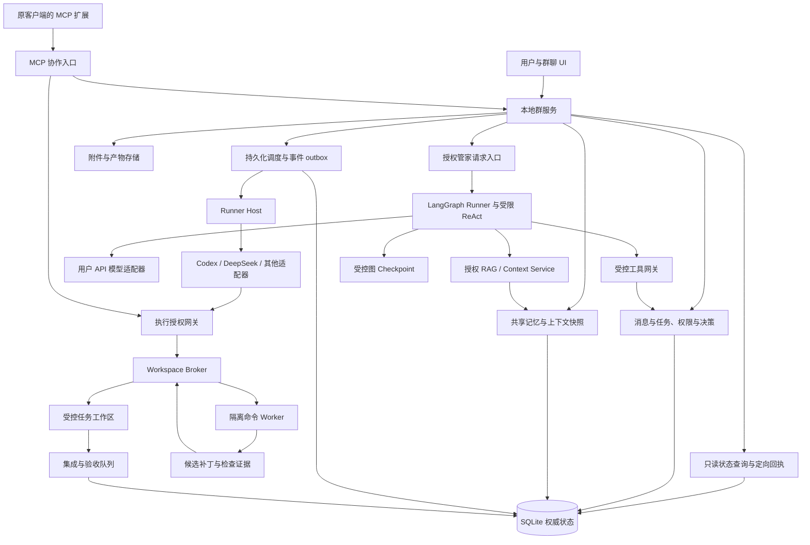

# 01 产品定义与架构

与 `README.md` 一起阅读；外部事实依据见 `06-evidence-decisions.md`，本文件的技术选型和行为默认属于设计建议。

## 1. 产品目标与成功标准

用户应能在一个项目群中完成：建群 → 邀请不同 agent → 分配职责 → 形成计划与任务 → 并行工作和互助 → 验收产物 → 完成项目。

核心成功标准：至少三个不同 harness/客户端的成员按用户分工共同交付一个前后端功能，用户可以追踪每项任务的负责人、输入版本、当前阻碍、产物和验收结果。

不以“支持多少模型”“聊天是否热闹”判断成功。用户给出的 DeepSeek 规划、Claude Desktop 前端、Codex 后端只是示例；平台不预设厂商能力排名。

## 2. 角色和对象

| 对象 | 定义 | 关键规则 |
| --- | --- | --- |
| User | 平台的人类用户 | 建群、授权、分配职责，身份不由模型自报 |
| AgentProfile | 一种 agent 的连接配置和能力档案 | 可复用配置；凭证单独保管 |
| Member | 具体 agent 或用户在某群的参与身份 | 一个档案可实例化多个成员；职责按群设置 |
| NativeSession | 具体 provider/harness 的会话 | 与成员/运行显式绑定，不能跨群静默复用 |
| Project | 仓库、环境、验收规则的集合 | 第一版一个仓库一个主群 |
| Room | 成员、消息、权限、项目记忆的协作空间 | room_id 是所有协作读写的授权边界 |
| Task | 一个可验收的目标 | 一个负责人，零到多个协作者和依赖 |
| Run | agent 对任务/讨论的一次执行尝试 | 失败后新建 attempt，旧记录不改写成成功 |
| Artifact | 文件、提交、测试、设计等结果 | 与实际 run、版本和校验摘要关联 |
| Decision | 已确认的需求或设计决定 | 草案与生效版本分开，保留依据 |

模型、agent、harness、原客户端不是同一个对象。把同一模型接入新运行器，也不能在 UI 上冒称为用户的原版 Desktop 会话。

## 3. 产品需求编号

| ID | 第一版需求 | 必须能够验证的结果 |
| --- | --- | --- |
| FR-01 | 建群、归档、邀请、移除 | 邀请限群/有效期/使用次数；撤销后无后续访问 |
| FR-02 | 自定义职责与成员能力 | 角色修改有版本和操作者；能力差异可见 |
| FR-03 | 消息、@、引用和话题 | 消息有稳定 ID，重复发送不会重复派工 |
| FR-04 | 共享记忆与决策 | 能查询原始依据，看到当前版本和成员同步状态 |
| FR-05 | 建任务、分配、依赖、领取 | 同任务不会同时产生两个有效负责人 |
| FR-06 | 成员互助和评审 | 协助关联原任务，原负责人不丢失 |
| FR-07 | 统一项目和代码工作区 | 每项改动可归属，原仓库未提交改动不被覆盖 |
| FR-08 | 成果、检查和集成 | 有接口/集成责任人和分阶段纵向场景；模块通过不能代替整体可用，证据绑定真实候选 |
| FR-09 | 权限、预算和暂停 | 用户能够停止调度、拒绝操作，状态如实显示 |
| FR-10 | 中断恢复和未读恢复 | 重启不漏已确认消息，不重复启动不明状态任务 |
| FR-11 | 三种目标 agent 接入 | 分别通过入群、收发、唤醒、执行验证 |
| FR-12 | 历史、检索、导出、备份 | 平台状态、Git 提交/引用与 dirty 成果闭合；原仓库不可用时仅凭备份恢复 |
| FR-13 | 状态、诊断、用量 | 区分连接在线、正在执行、待用户、未知成本 |
| FR-14 | 数据隔离 | 群/身份/执行 grant 隔离；同成员的公开执行不能取回另一次私密执行的数据 |
| FR-15 | 安装、升级、迁移 | 在干净设备上可复现，迁移失败可恢复 |
| FR-16 | 需求与上下文变更 | 需求/禁止事项/接口有版本及产物检查，失败方法可交接；读回执不能证明已遵守新要求 |
| FR-17 | 定向 @ 的内容隔离 | 发送者和指定成员可读；历史、检索、上下文、回复和事件全链路遵守可见范围 |
| FR-18 | 不中断工作地询问 | 进度来自只读状态；查询不触发新输入、取消、重启或抢占；无关提问排队，匹配等待请求的 continuation_reply 可恢复该等待点 |
| FR-19 | 自动本地 Git 版本 | 基线、WIP/检查点与实际 diff 关联，恢复不重复提交，不混入用户改动或自动 push/merge |
| FR-20 | 文件独占与变更 Markdown | 同项目逻辑路径跨 worktree 单写者；撤权/对账后才重试；完整变更集/一致快照交接，依赖失效阻止合并 |
| FR-21 | 可更名协调员 | 权威状态由服务统计；模型提议/派工受限，不读默认私信、不打断工作成员 |
| FR-22 | 受控人工介入 | 范围冻结/检查点、human_run 独占、实际 diff 和管家报告；相关成员同步并重验后继续 |
| FR-23 | 验收与测试保护 | 生效验收不可被作者自改；测试弱化单独审查，证据绑定固定产物与环境 |
| FR-24 | 运行环境隔离 | 数据库/缓存/端口/浏览器/测试账户按资源归属隔离；共享资源受互斥和版本控制 |
| FR-25 | 根工作流与无进展控制 | 子任务/求助/重试累计预算，停滞有证据与停止扩展条件，恢复不清账 |
| FR-26 | 用户预期与体验验收 | 关键假设可确认，尽早提供真实场景体验，反馈关联版本/修改任务/验收变化 |
| FR-27 | 升级行为回归 | 配置指纹与真实重复任务比较；能力连接正常不等于行为资格通过 |
| FR-28 | 资源生命周期与清理 | 分类型并发/配额，清理核对活跃状态及恢复引用，长跑/休眠恢复可验证 |
| FR-29 | 数据外发控制 | 读取、联网、发送和发布分别授权；模型输入及其他外发在传输前受控 |
| FR-30 | 用户 API 管家与受限流程 | 确定性服务 + LangGraph/受限 ReAct；模型能力探针、持久化/幂等、模型离线时基础控制可用 |
| FR-31 | 委派与私密任务披露 | propose_only 默认；委派边界可撤销，内容披露与计划批准分开，干净上下文向指定成员派工 |
| FR-32 | 并发计划与安全再分配 | 跨图/人工任务修改采用计划头与资源版本 CAS；原子应用、跨 attempt 动作去重，活动 owner 变更须交接 |
| FR-33 | 授权 RAG 与图记忆 | 来源/版本/ACL、固定约束、独立 Embedding 授权、撤权阻断恢复、索引可重建且不替代业务真相 |

以后扩展：多人账户、公网服务、多机器 worker、多仓库、移动端、团队模板和更复杂调度。第一版不实现 Matrix 联邦、公开 agent 市场、跨客户端私人记忆导入、远端生产系统自动部署。增加它们需单独设计，不视为本方案隐含能力。

## 4. 界面与关键操作

三栏界面：左侧群和未读；中间群消息/任务话题；右侧成员职责、计划、共享记忆和产物。聊天页内能打开任务、决策和文件，无需了解内部协议。

成员状态分开呈现：连接状态、运行状态、最近活动、待同步记忆版本。已连接 MCP 但不会主动处理消息的成员显示“需要在原客户端继续”，不能显示“全自动在线”。

建群向导：选项目（或纯讨论）→ 邀请 agent → 查看接入检查结果 → 分配职责 → 设置自动化、目录与预算 → 发布第一条目标。不得以“刚进入群”推定可写文件或运行命令。

用户在聊天中说“后端交给 Codex”时，平台先产生可见的分工变更卡片。若该用户已有相应权限且句意无歧义，可以直接应用并展示结果；歧义时保留为草案。已授权范围内的普通任务不重复要求用户确认。

群聊/任务话题的输入区同时显示可见范围和意图：例如“仅你与 Codex 可见 · 查询进度”或“全组可见 · 发起讨论”。用户单独 @ 某成员时默认定向可见；意图包括发消息、查询进度、分配任务和显式控制。路由优先使用界面选择与确定性规则，歧义时保留为只读/待明确，不将私密正文送给另一个 agent 分类。

私密请求转跨成员任务先按 11 §5.2 生成并批准指定载荷副本，不能把“批准计划”当作私信转发许可。UI 分别展示委派模式、内容接收者/服务方与已执行回执；所有任务变更走 11 §9.3 的版本检查，不能由 UI 直接覆盖活动负责人。

消息编辑追加 revision；撤回留下 tombstone。编辑/撤回已被执行的指令不会撤销真实副作用，UI 应提供关联的取消或修复入口。

图片、设计稿和文件先保存为附件，并继承消息可见范围。仅有阅读权限且支持图片输入的成员收到二进制内容；有权限但不支持图片的成员可请求描述。没有阅读权限的成员不收到文件信息、缩略图或下载链接。

开发前用使用场景、预期行为和验收示例确认关键业务假设；普通技术细节在授权内由 Agent 决定。尽早展示标明真实/模拟范围的原型或纵向流程，用户反馈绑定实际预览版本。人工修改使用明确的介入入口，范围冻结和检查点完成后才授予 human_run 修改资格；管家根据实际 diff 汇报，通知不代表成员已经同步。完整运行规则见 10 §4/7。

## 5. 群消息与发言规则

| 消息意图 | 默认动作 |
| --- | --- |
| 普通说明/闲聊 | 保存历史与未读，不全员调用模型 |
| @某成员询问进度 | 仅发送者和该成员可见；平台读取已有状态并私密回复，不向正在执行的工作 turn 投递输入 |
| @某成员发出指令或普通问题 | 仅发送者和该成员可见；按意图执行/排队，忙碌时默认等当前任务自然结束，不能自动抢占 |
| 回复已登记的等待问题 | continuation_reply 绑定 request_id/run/epoch，验证答复者和范围后恢复该等待点；不进入任务结束后的队列 |
| @全体讨论 | 建 discussion，有明确议题、参与者、截止与结束条件 |
| 分配任务 | 生成任务，校验 owner、范围、依赖和验收条件 |
| 求助/评审 | 关联原任务，创建 help request 或受限子任务 |
| 决策变化 | 发布新版本，通知受影响成员/任务 |
| 提交成果 | 收集产物并进入验收，不直接宣布项目完成 |

第一版讨论默认每成员一轮观点、一次汇总；用户可继续展开。建议每个自动协作链默认最多 8 次 agent 响应、2 层求助、10 分钟讨论时间，到界限后给用户可继续的状态。编码任务不因讨论时间限制被误杀，其超时单独配置。

消息路由使用显式 member_id，而非显示名称匹配。单个 @ 的 audience 为发送者与该成员；多个 @ 则为发送者与显式列出的成员，界面发送前显示名单。@全体或明确群公开消息才使用 group audience。回复沿用原消息 audience；在回复中 @ 新成员不能自行扩大权限。定向内容不得进入其他成员的消息、摘要、任务描述、附件、搜索和上下文。状态消息、工具日志和模型流式片段不触发自动对话。

进度回复显示“平台状态回执”、观测时间、已完成检查点和当前阻塞；不冒充工作 agent 的新回复。需要本人回答的解释性问题进入定向队列，先返回排队回执；当前任务自然结束后再处理。详见 07。提供自带、可更名的协调员入口。Coordinator Service 负责投递、状态统计、权限、文件锁和终止条件；可选 Coordinator Agent 负责自然语言规划和说明。被 @ 查询进度时默认直接返回服务报告，不额外调用或打断工作成员。模型分析输入不能继承用户的全部权限；详见 08。

## 6. 协作权限与互助

成员职责包含：目标、负责模块、允许操作、可请求帮助的成员、是否可提议子任务、是否可评审。平台展示描述性职责，同时用具体 policy 校验操作。自然语言角色描述本身不是安全边界。

默认 agent 可提议任务和修改，但不能改成员权限、提高预算、改变用户目标或自批敏感操作。用户可以授予“在既定模块内分配子任务”的范围授权，授权带有效期/额度/撤销记录。

一个任务始终有一个 accountable owner。协助分四类：回答问题、方案建议、产物评审、受限改动。只有最后一类建立独立写入任务。评审者不能仅凭作者的“测试通过”文本直接把任务标成完成。

求助需要明确问题、期望产物、相关上下文、期限和阻塞关系。来自定向消息的内容不得自动转给其他成员求助；需要扩大受众时，由用户明确发布选定内容，再发起协作。等待图必须检测循环；A 等 B、B 又等 A 时，转为讨论或通知用户，不能无限等待。运行池预留一个可用于短答/评审的槽位，或者在所有槽占满时让支持 checkpoint 的等待者释放槽位。无法挂起的客户端不得伪称已挂起。

## 7. 总体架构



两条参与路径共同使用群成员身份、任务和记忆：

- 原客户端主动调用 MCP，读取信息、领取任务、提交结果；平台仅声明已验证的监听/唤醒能力。
- 可托管 harness 由 Runner Host 启动，通过官方协议驱动；拥有明确进程和权限边界。

内置管家使用用户自带模型 API，由平台提供受限工具循环；它不替换 Codex、Claude Desktop、DeepSeek Harness 的客户端和账号。其他通用 API 工作成员可后续增加，UI 不能冒称原客户端能力。

## 8. 模块职责与实现边界

| 模块 | 唯一主要职责 | 不承担的职责 |
| --- | --- | --- |
| UI | 渲染群、任务、状态与用户操作 | 不持有模型密钥，不直接写数据库或执行 shell |
| Identity/Policy | 用户/成员身份、服务签发的执行 grant、逐请求交集授权与撤销 | 不从聊天正文推断管理员身份 |
| Room Service | 消息、成员、事件和阅读游标 | 不实现 provider 会话协议 |
| Task Coordinator | 依赖、领取、租约、状态和工作流 | 不把 LLM 自述当数据库事实 |
| Context Service | 按 audience 授权构建版本化记忆、检索和快照 | 不向公共记忆复制定向内容，不覆盖 provider 私人记忆 |
| Status Query Service | 读取已存在的运行投影，生成带来源时间的定向状态回执 | 不调用模型、不向工作 turn 注入提问、不执行命令或改变任务 |
| Adapter Gateway | 协议转换、能力探测、标准事件 | 不拥有群业务规则 |
| Runner Host | 进程、目录、终止、重连与检查点 | 不替原客户端做未经支持的内部注入 |
| Workspace/Integration | 项目逻辑文件独占锁、Broker 写入、Git 检查点、变更 Markdown、检查和合并 | worktree 不豁免独占锁；不决定项目需求 |
| Coordinator Agent（模型可关闭） | 用户自带 API 的受限 ReAct + LangGraph；计划、解释、授权委派，详见 11 | 不是另一个权威调度器，不继承用户私信权限、不可自行提高预算 |
| Coordinator Graph/Model Adapter | 固定图版本、API 能力、执行租约、等待与回执引用 | 不直接写业务表或让模型改图/工具集合 |
| Knowledge/RAG | 复用 Context Service 的来源/ACL/版本；授权全文与按需语义检索 | 不以相似度替代当前状态，不复制另一套项目记忆真相 |
| Environment/Resources | 环境清单、分类并发许可、端口/DB/缓存/浏览器归属、清理前提 | 不把 worktree 隔离等同于完整环境隔离 |
| Acceptance/Evaluation | 版本化验收、场景/用户反馈、检查证据及升级行为回归 | 不用模型投票代替实际验收 |
| Egress Policy | 数据类别、目的地、目的与动作授权及发送前检查 | 读取或联网资格不自动授权上传/发布 |
| Persistence/Outbox | 原子状态变化和可靠待办 | 不宣称外部副作用可以 exactly-once |

第一版保持模块化单体的业务组织，不拆远程微服务。权限边界必须分离 Group Service、Broker/Runner Controller 与低权限 Worker 的身份；采用 09 §4 的本地部署验证基线，不能只分进程仍共用有权读取一切的主用户身份。启动器展示“关闭窗口”和“停止后台工作”的区别，后台运行需用户可见、可退出。

## 9. 建议技术基线与替代条件

当前前端基线（2026-11-14 用户明确要求原生）：C# / .NET 10 / WPF 原生 Windows 控件，不使用 Electron、WebView、Tauri WebView 或外部浏览器。Node.js 本地服务与 SQLite 保持权威；REST 承担命令/查询；未来独立 SSE 事件与 Git 证据仍按阶段门槛实现。原生客户端仅替换交互和所属服务宿主，不扩大 Agent 执行权限。详见 W05-NATIVE-DESKTOP.md。

选择理由是满足用户明确的原生目标，以系统控件、单一小型客户端层和现有服务契约降低交互及维护复杂度，属于本项目判断。WPF 框架依据见 [E34]，本轮锁定官方 SDK 10.0.404 / runtime 10.0.15，元数据与校验摘要见 [E35]。构建包自包含运行时；框架资料和编译成功不等于完整用户体验已验收。旧 Electron 资料 [E11] 仅作历史参考。

群服务的 SSE 是自有事件协议，与 MCP 是否支持 legacy SSE 无关。MCP 生命周期和通知格式由 adapter 的协议版本协商处理 [E07]。

管家方案采用 TypeScript LangGraph 稳定工作流 + 受限 ReAct，用户生成模型 API 与 Embedding 档案分别管理。LangChain 适配可按需要选择；具体版本、checkpointer 和实际模型能力在 C0/P0 验证锁定，不以统一方法名证明兼容，见 11 和 [E23]–[E31]。

数据库部署在本地应用数据目录，不能放网络共享盘。数据库只对服务开放。SQLite WAL 的同主机限制和备份机制见 [E12][E13]。不在 MVP 引入 Redis、向量库或消息中间件；确有规模瓶颈再加入。

若未来提供多人服务，服务端采用 PostgreSQL 和对象存储；保留本地 worker，凭受限授权拉取工作。通过迁移工具一次性迁移权威数据，第一阶段不做 SQLite/Postgres 双写。

## 10. 仓库与开发分工建议

以下只是未来实现的建议布局，本次没有创建这些代码：

```text
apps/desktop            桌面壳与 UI
services/coordinator    群、任务、权限、记忆、outbox
services/runner-host    进程和工作区运行控制
packages/contracts      API、事件、JSON Schema 与生成类型
packages/adapters       Codex、DeepSeek、外部 MCP 成员
packages/mcp-gateway    对原客户端暴露协作工具
packages/workspaces     文件锁与 journal、Broker、Git、变更记录、检查和集成
packages/storage        数据迁移与备份
packages/coordinator    计划/委派/披露契约与服务调用
packages/graph-runner   受控图执行、恢复、模型适配
packages/knowledge     来源/全文/按需嵌入，复用 Context Service
fixtures/coordinator   模型/工具回执、并发、隐私与恢复反例
fixtures/compatibility  经脱敏的协议样例与重放测试
```

职责分工按这些边界安排；接口先定，适配器实现不得直接改任务表。所有模块错误必须带稳定 code 和 trace_id，群里只展示用户需要的解释。

## 11. 非功能目标

建议测试环境：Windows 11、8 核 CPU、16GB 内存、本地 SSD；记录实际设备和所有版本。支持 10 个群、每群 10 个成员、总计 3 个同时运行的 agent；其中模型进程占用另计。

建议验收目标：本地消息持久化确认 p95 ≤ 300ms；事件写入后到 UI 可见 p95 ≤ 1s；重启后状态核对 ≤ 30s；100,000 条文本消息时分页与索引查询 p95 ≤ 500ms。它们不是实测结论，P0 确定负载样本，未达标必须报告。

平台自身安全取消请求提交目标 ≤ 1s；实际外部进程停止依赖 adapter，必须显示“正在停止/无法确认”，不能用计时器直接显示已停止。模型延迟与 provider 可用性不计入本地 UI SLA。

## 12. 范围改变的控制

需求变更写 Decision revision，并显式影响任务、上下文快照和测试用例。修改 shared interface 时，受影响任务必须重新确认版本；原结果保留，但不直接进入合并。

若原客户端自动化不可行，辅助模式属于范围变化。不得以换成 Claude Code、SDK 或新模型偷偷满足 Claude Desktop 的验收项。选择辅助模式、替代成员或等待能力变化必须形成产品决定。

## 13. v1.6 从原则到可验证协议

本版不增加业务需求编号，细化 FR-05/09/10/11/13/18/20/21/25/26/27/30/32/33。计划应用不等于开始，管家结束不等于项目结束；部分执行按依赖隔离，无关任务在原授权内继续，暂停派工/停止计划/撤销代码分开。用户看到的全局状态必须来自其有权读取的范围。

12 是部分执行、等待交接及验证材料的维护源。P0 必须冻结最小契约，并在同一实际配置中联合验证客户端与隔离；P1 验证事件/恢复故障；P2 测协调质量和真实锁效率；异常 UX 先低成本验证，不用完整 UI 投入替代可行性。固定样本不等于已运行测试，管家模型能力与原客户端资格分别验收。
