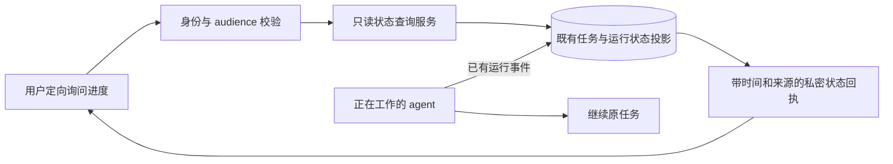

# 07 定向消息与不中断进度查询

版本：v1.4，日期：2026-11-14。依据用户明确补充：在群内单独 @ 一个 agent 发指令或问进度，其他 agent 不读取这句话；询问时不能打断正在进行的任务。本章是需求与设计约定，没有实现软件。

## 1. 用户看到的行为

| 用户操作 | 可见范围 | 对当前任务的影响 |
| --- | --- | --- |
| `@Codex 后端做到哪了？` | 仅发送者与 Codex | 平台读取已记录的运行状态并私密回复，Codex 继续工作 |
| `@Claude 为什么选择这个组件？` | 仅发送者与 Claude | 能从已有授权决策回答则给带来源回执；需要本人作答则排队，当前任务继续 |
| `@Codex 接下来增加导出功能` | 仅发送者与 Codex | 新指令入队，默认当前任务自然结束后再处理 |
| 回复当前“字段可空吗”请求卡 | 继承请求 audience，且在 run 授权内 | continuation_reply 验证 request_id 后恢复对应等待点，不排到任务结束 |
| `@Codex 立即停止当前任务` | 仅发送者与 Codex | 明确 control 操作，经既有权限校验后请求停止；不属于普通询问 |
| `@Claude @Codex 确认接口字段` | 发送者、Claude、Codex | 只向名单中的成员路由，按忙闲与意图处理 |
| `@全体 讨论下一阶段` | 本群有权成员 | 有边界的群讨论，不自动抢占正在执行的代码任务 |

发送前显示“仅你与 Codex 可见”和询问/指令类型；历史中同一消息只出现在有权主体的视图中。无需为每次进度查询弹确认窗口。

## 2. @ 同时确定收件对象与消息可见范围

单个 @ 的消息默认是 direct audience：发送者 + 被明确提及的成员。多个 @ 使用显式名单。群公开消息与 @全体使用 group audience。用户在正文引用代码或普通文本中的 `@` 不应被自动识别为新收件人，实际收件列表由 UI/member_id 确定。

对未被指定的 agent：不投递、不唤醒，不出现在其历史、搜索、摘要、上下文、未读计数、消息预览、附件列表、事件回放、诊断导出或新成员 onboarding 中。知道 message_id 也不能绕过授权查询。

回复、附件、衍生任务描述与私有决策继承原可见范围。发送回复时 @ 新成员不能扩大权限，转发/求助也不能悄悄复制私信。具有协调员或群管理员描述的 agent 不因此获得读取所有定向消息的能力。

群内共享数据库继续成立，但每次读取按资源授权过滤；共享项目事实只包含明确公开或对当前成员授权的内容。

## 3. 防止间接泄漏

- 检索、摘要和输入构建先做 ACL 过滤，再做模型处理；不能先读取全群私信生成摘要，再尝试遮挡。
- 摘要、向量/全文索引结果、缓存、状态回执、附件下载、引用源和快照都保存/校验可见范围。
- 不把私密消息正文、原生输入快照或日志写到所有 agent 可读的项目目录；群数据库与私密产物由服务持有。
- 含私密上下文的原生会话输出继承窄 audience。不能直接复用它来生成面向全组的回答并仅靠提示词要求保密；需要新的受限公开上下文，或用户显式批准发布选定内容。
- 状态投影本身也可能带有私密任务名称/阻塞原因，不能只过滤消息而公开全部任务标题。
- 房间内部 room_seq 不给其他成员；用户侧按用户可见流、agent 侧按执行 grant 可见流排序，避免私信产生额外未读、占位消息和公开活动变化。
- 撤销成员授权后，缓存、未读回放、旧快照、导出和恢复都重新检查权限。已发送到外部客户端的历史不能承诺收回，但不能继续发送新内容。

用户明确选择“发布给全组”时，创建新的公开内容对象，显示本次将公开的内容与受众。原私信保持私密；公开对象不能带回指向原私信的可访问链接、预览或私密溯源数据。

私密指令最终产生的代码或设计可以按用户授权进入共享产物。其他 agent 可能从公开产物了解改动；本规则保护原私信和未发布派生内容，不宣称能阻止对已公开成果的推断。未经用户决定，不因为“有利于协作”而公开私密指令。

### 3.1 同一成员的不同执行也必须隔离

成员能够读取私信 A，不代表它在公开任务 B 的执行有权读取 A。每次 API/MCP/事件调用都执行“当前成员权限 ∩ 服务签发的 execution_grant ∩ 资源 ACL”；grant 绑定 run/epoch、原生连接和允许的数据域。历史、搜索、附件、单 ID 查询、poll/wait、快照、缓存、下载和重连均适用，不信任客户端自报 session_id [E09]。

公开 B 只得到自己的 grant/feed/cursor，不持有成员通用读取凭据。原生上下文、记忆、插件配置和工具缓存也要分域；无法可信绑定的应用级 MCP 连接固定为窄范围，不能通过切换聊天获取更大权限。具体部署与降级见 09 §3–4。

## 4. 查询进度走旁路，不进入工作会话

查询服务只读取已有事件、任务阶段、检查点、阻塞、最近活动、产物和可观测用量，不向执行会话发送新 prompt/steer/cancel/resume/restart，不调用另一个 agent 代答，也不运行测试或其他命令来刷新状态。

progress_query 标记 requires_agent_action=false：询问与回执写入用户侧私密会话视图，不进入 agent 工作队列、活动 turn 的默认 MCP 轮询或自动上下文注入。即使目标成员有读取资格，当前工作执行也必须通过自己的 grant；查询与回执不进入其默认工作流，不能因宽泛轮询而间接注入。

工作流仍可正常推进；查询不得导致 run 被更换、上下文被追加、租约重新分配或执行槽被抢占。查询产生的私密 message/inquiry/audit 写入是允许的，所谓“只读”指不修改工作任务和环境。

进度服务使用独立读取路径与有界并发、缓存，避免高频查询占满写入队列或执行资源。可合并相近时间的刷新请求，但每次回复标注对应的观测时点。

## 5. 回执应诚实表达来源

示例：

> Codex · 平台状态回执（截至 14:32:10）  
> 当前任务：登录接口。  
> 已记录：接口实现已提交；正在运行集成检查。  
> 当前没有记录到需要用户处理的阻塞。  
> 你的查询没有打断该任务。

这是一种回执模板，不是假设能够观察模型的实时想法。阶段、检查点和阻塞只使用实际记录；未记录的信息显示未知。没有可靠总工作量时不生成进度百分比；没有可靠估计时不生成剩余时间。

最近记录已过期时写“最后记录于……，当前状态待确认”。客户端离线且没有实时事件时，不为刷新状态唤醒/重启它。页面可以继续展示已存在的历史结果。

如果该 agent 不提供足够运行事件，允许展示粗粒度信息，如任务已分配、最近一次报告、连接状态。该限制纳入能力面板与兼容测试，不能宣称每个客户端都有同样的实时进度。

## 6. 不是所有问题都能由状态服务回答

“还在跑吗”“检查过了哪些”“最近完成了什么”可以从已记录状态回答。“为什么这样设计”“现在能否保证满足某需求”可能需要 agent 本人推理。

这里指用户发起的无关新问题，不包括 agent 正在等待的回答。需要本人回答时：保存私密问题 → 返回“已排队，当前任务继续” → 等当前任务自然结束 → 用相同成员身份、合适的授权会话处理 → 以同一 audience 回复。不要为了立即回答另开一个会话并冒称是原执行者的当前判断。

已有决策可直接引用作答，但标明来源与时间；无法判断时不补造答案。意图歧义时不执行修改，平台可让用户明确选择“查询”或“调整任务”，不把这当作每次询问都要重新授权。

若当前任务需要用户响应一个权限请求，平台可以报告“正在等待你的授权”；用户本次问进度不等于同意该权限请求。必须走独立 approval 操作。

### 6.1 回答已有问题走 continuation_reply

Agent 的“字段是否允许为空”在服务登记 input_request 后进入 waiting_user。用户通过该请求卡片回答“允许”，服务校验 request_id、当前 run/epoch、答复者权限、audience、schema、deadline 和幂等键，再通过独立 respond_input 恢复该等待点。它不能等到整个任务结束才投递。waiting_peer 的同伴求助同理。

过期、错误 run、重复冲突或未经授权的回答明确拒绝，不转换为新任务。回答须能进入原 run 授权范围；私密回复不能未经发布进入公开上下文。权限批准继续走 approval，普通“允许”不增加 shell/文件/网络权限。

adapter 必须单独声明请求输入、接受回答和恢复等待点的能力；不支持时显示阻塞/需人工继续。断连后投递结果未知要核对，不能盲重发或静默重启。具体协议差异、状态机及例子见 09 §7。

## 7. 与原客户端能力的关系

这个设计尽量通过平台持有的观测数据满足查询，而非要求客户端在工作中再接受一个模型回合。因此，即使某客户端不支持并行对话，也不能以“查询”为由打断其活动 turn。

需要验证的字段：observation_mode（events / cached_report / none）、last_observed_at、can_observe_without_prompt、can_defer_message。没有经过验证的只读状态接口时，默认只用已有数据，不临时调用有副作用的方法。

用户显式停止或调整任务是另一条控制流程；只有这种明确意图才允许按平台权限调用实际受支持的控制能力。所有控制行为都写因果记录。权限撤销、依赖失效、隔离违规属于服务的运行安全规则，可封锁后续写入并按核对流程收敛；它们不能由一次进度查询触发，不能因“不打断查询”而继续放行无效写入。

## 8. 与自带协调员的衔接

“@项目管家 汇报各个 agent 进展”默认是 progress_query，由服务生成权限内汇总并标明平台来源，不调用或打断任何工作 agent。入口可以更名，后台身份稳定。用户另要求模型分析/规划时，才向被点名的协调员模型提交只读快照，输入按其独立权限过滤；不能把用户可见的全部私密任务交给它。

模型分析并不修改 v1.1 的定向隔离和不打断要求。不能回答的实时状态仍标未知，不逐个向忙碌成员追加询问。

## 9. 实施与验收变化

新增 FR-17（定向内容隔离）、FR-18（不中断询问）；v1.1 最低验收由 48 项增加至 60 项，新增 AT-49 至 AT-60；v1.2 扩展至 78 项，v1.3 扩展至 110 项，包含跨执行隔离和等待答复反例；v1.4 扩展至 160 项，新增人工介入、运行交付与外发控制。测试需覆盖 API、MCP、UI、检索/摘要、附件、缓存、事件和恢复，而不是只检查聊天窗口是否隐藏了消息。

对于不中断查询，用执行事件记录核对：查询 trace 下没有 prompt/steer/cancel/restart、命令执行、额外 agent run 或任务权限变化。并发任务自然完成或产生新进度不算查询打断；必须按因果关系判断。

## 10. 人工改动通知、用户反馈与外发

人工修改通过显式控制入口冻结受影响范围，沿用受控写入/检查点/交接；它不属于普通提问。管家报告来源于实际 diff、版本和检查证据，只向获准且受影响成员投递。notified/read 与 snapshot_materialized/revalidated 分开；旧工作不能仅凭阅读回执恢复写入。详见 10 §4。

用户的“不符合预期”保存为有来源、有 audience、有候选版本的反馈，管家转成场景差异与修改任务；关键验收/目标变化需要明确决定，不能暗改验收。进度查询仍不触发评测、诊断命令、人工接管或新的模型回合。

私信可读不代表可发给另一个外部服务。进入原客户端/模型上下文前执行独立 egress policy；协调员的模型分析也受数据外发与 root 预算约束，服务生成的确定性报告不增加模型调用。

## 管家私密派工的补充规则（v1.5）

@管家 的原始消息仍只属于原 audience。私密内容及其派生计划要交给其他成员，须按 11 §5.2 形成精确载荷、附件版本、接收成员、用途和服务方范围的披露卡片；内容披露与派工批准是两个类型化决定，不因同一个确认按钮而合并成无边界授权。

一般自动委派不允许自由转发私信；只可复用本来公开且获准的对象，或用户已确认的指定载荷副本。新任务采用新的执行授权与干净上下文，不继承私密图 checkpoint/摘要。不能靠“模型已去敏”取代用户对指定内容的披露决定。计划/载荷/收件者变化需复核；取消批准后未发送的任务内容不得继续外发。

进度询问仍只查已有投影。要求“分析为什么阻塞”才进入可计费的管家分析，并显示使用范围；用户可见但管家模型不可见的私密任务继续由服务直接生成用户卡片。忙碌工作 Agent 不因披露/计划批准收到抢占输入，待自然安全点或匹配 continuation_reply 通道处理。

## v1.6 等待与异常状态的补充

12 §5 的 workflow wait 与 input_request 不混用：等待工作结果由服务注册/通知/消费，回复成员问题仍走绑定请求的 continuation_reply。事件先完成后注册仍可从当前状态解析；过期/撤销等待不能自动变成新任务。私密 run 的旧等待结果不能被同成员公开 run 读取。

12 §8 四条异常交互由权威状态驱动，纯进度无模型调用。完整计划聚合仅在整个范围可见时返回；受限视图不得公开隐藏任务数量、私密等待原因、原话或来源标题。必要私密约束不可合法披露时阻塞相关任务，不把它省略后继续。
