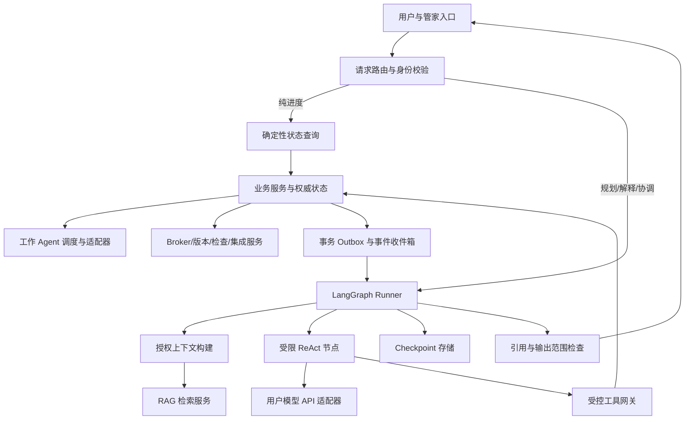

# 11 管家 Agent 专项设计 v1.2

日期：2026-11-14（Asia/Tokyo）  
状态：设计建议稿，供实施评审；未实现、未运行真实模型或产品验收。  
范围：群聊式多 Agent 项目平台中的管家子系统，不重新设计整个平台。  
兼容基线：平台总方案 v1.6（保留 v1.3 底层规则与 v1.4 运行规则）。本章是管家设计的唯一维护源，直接作为专项阅读稿；plan 目录整理后不再保存第二份相同正文。平台权限、任务、人工介入、预算、环境、验收与版本规则复用 02/09/10，不把建议等同于已验证能力。

版本关系：平台 v1.6 包含本专项 v1.2。发生冲突时不以“后写文档覆盖旧规则”处理；由 02 的共享契约与 09/10 的安全不变量约束本章，未解决冲突不得进入实施。

## 1. 已确认要求与边界

### 1.1 已确认的需求

1. 不同工作 Agent 发挥各自优势，完成完整项目的不同部分；管家协调依赖与集成，不要求所有成员重复做同一个任务。
2. 用户能够描述目标，但不必具备完整技术实现能力；需要技术判断时，管家把问题转为可理解的选择和影响。
3. 管家使用用户自己接入的模型 API。工作 Agent 的客户端、账号和模型接入保持独立，不因此被替换为管家的模型。
4. 采用 ReAct 思路处理需要推理和工具选择的过程，以 LangGraph 管理流程、持久化、等待与恢复。
5. 加入 RAG，检索项目知识、决策和历史变更；不能用检索结果代替实时任务状态。
6. 允许人为介入；修改后管家汇报变化，并组织相关成员同步实际版本。
7. 查询进度不打断正在工作的成员；定向消息及其派生内容遵守原有可见范围。

### 1.2 本方案的硬边界

- 模型没有数据库管理、权限修改、任意 shell、任意文件写入或默认合并/发布权限。
- 管家说“已派工/已完成”不是事实；只有平台操作回执和验收证据能确认。
- 同一逻辑文件跨 worktree 的独占要求继续适用，不因管家、重试或人工介入取消。
- 断线、超时、恢复和模型更换不能扩大权限，不能盲目重做可能已成功的外部操作。
- 默认不把私密资料、输入、trace 或密钥送到用户未允许的服务方。
- 所有数值上限均为建议起点，不是性能承诺；用户业务目标不因这些默认值静默改变。

## 2. 架构选择

| 路线 | 优点 | 主要问题 | 决定 |
| --- | --- | --- | --- |
| 单个自由 ReAct 循环 | 原型简单，行为灵活 | 难以保证状态、授权、等待和恢复；容易反复查询与重复副作用 | 不作为完整管家的执行架构 |
| 完全确定性流程 | 可预测、易验证 | 自然语言需求、风险分析和复杂计划能力有限 | 用于状态、权限及操作执行部分 |
| 确定性外层 + 受限 ReAct + RAG | 保留模型灵活性，同时约束副作用与恢复 | 需要明确服务、图状态和模型之间的边界 | 推荐方案 |

LangGraph 可组合 workflow 与 agent；框架能力不自动完成本项目的业务授权、幂等和跨系统恢复。[E23][E24]

## 3. 总体结构与职责



图中模块是逻辑职责，不要求拆成微服务。首版建议沿用本地模块化单体，模型调用和图执行使用受控后台运行器。

| 模块 | 负责 | 不负责 |
| --- | --- | --- |
| Coordinator Service | 身份、策略、动作验证、审批、业务状态、调度预算、事件 | 不让模型直接改表 |
| LangGraph Runner | 请求流程、节点执行、持久化、等待、错误分支、恢复 | 不另建独立任务真相 |
| ReAct 节点 | 查询必要信息、分析、提出计划、选择允许的工具 | 不自行提权、释放锁、判定验收通过 |
| RAG Service | 授权检索、版本选择、来源、索引更新 | 不决定当前锁、预算、审批和任务完成状态 |
| Model Adapter | 用户 API 配置、能力验证、超时、输出解析、用量 | 不把所有兼容接口视为等价 |
| Tool Gateway | 将模型动作转换为受控业务请求，审计与去重 | 不提供万能 SQL/shell 工具 |
| Output Builder | 固定状态卡片、引用、受众约束、事实与建议分离 | 不把模型措辞变成已执行事实 |

**领域任务 DAG 与 LangGraph 执行图分开。** 项目任务及依赖在业务库中；不为每个项目模块动态生成一套不可控的图拓扑。管家使用稳定工作流操作领域 DAG。

## 4. 用户自带 API 与模型配置

### 4.1 模型档案

每份配置保存：profile_id、provider/integration 类型、base_url、model_id、secret_ref、能力检测结果、配置 revision、超时、并发、用量可观测性、数据外发范围。生成模型、Embedding 模型分别配置；重排模型以后可选。

- API Key 放操作系统凭证存储或受控秘密存储；业务库仅保存引用。
- 密钥不进入 prompt、图状态、checkpoint、工具响应、日志或导出包。
- 地址只能由已授权用户配置，模型不得通过工具修改目标 API 地址。
- 自定义端点检查协议、重定向和目标；本地模型地址可由用户明确允许，不能笼统禁止所有 loopback，也不能默许模型访问任意内网或云元数据地址。
- 请求携带的业务范围不能被配置中的任意 provider 参数覆盖。
- 调试追踪默认本地；外部遥测/追踪必须另行启用并符合数据去向策略。

### 4.2 能力验证与分级

连接测试使用最小合成数据，预先说明可能产生少量调用成本，不自动上传真实项目验证。

| 能力 | 验证 | 失败后的行为 |
| --- | --- | --- |
| 文本生成 | 请求/响应、错误、编码、超时 | 无法连接则禁用模型路径，保留确定性功能 |
| 工具调用 | 参数、tool call ID、工具结果回传、重复调用 | 只允许总结/草案，不自动执行动作 |
| 结构化输出 | 本地 Schema 校验与一次受限修复 | 输出无效不派工，返回需重试/人工处理 |
| 流式输出 | 截断、断流、重连、最终结束标识 | 可退化非流式；不执行半段工具参数 |
| 上下文输入 | 实际模型与集成限制 | 使用保守预算；必要依据不足则阻塞/拆分 |
| 用量 | 字段存在性、账单延迟、未知 | unknown，不按 0 结算；使用调用/时长上限 |

能力档案记录检测时间、模型/接口版本和探针证据。不把“OpenAI-compatible”字样作为全部能力通过的证据。统一模型接口方便适配，但具体能力仍需验证。[E29]

### 4.3 更换模型与故障降级

- 每次管家运行固定模型配置 revision；不得在节点重放时无记录切换模型。
- 用户更换配置默认影响新运行；进行中的运行在安全边界结束或由用户明确迁移为新 attempt。
- 不静默切换服务方，不自动转发全部旧历史。
- API 不可用不影响纯进度、权限判断、取消入口、已有授权工作任务及人工介入。
- Embedding 故障不阻塞当前状态查询；可退回授权的关键词检索，但必须显示语义检索不可用。

### 4.4 路由与中转链路可核对性

首版默认一个管家生成模型档案，工作成员仍由用户指定，生成/Embedding/可选重排的职责和授权分开。ReAct 用于有界探索，结构化计划和服务状态机负责调度；不默认增加独立规划/反思模型。是否继续、重新检索、拆分或请求人工由任务证据、能力、授权和预算共同决定，不按厂商名称或“最强模型”标签分配。

模型档案增加 endpoint_kind（官方/自定义中转/本地）、endpoint_ref、adapter/protocol_revision、requested_model、reported_model、identity_verification、routing_policy_revision 和候选配置能力证据。完整地址、query/header 中的凭据只留受控配置，诊断默认显示别名及脱敏目标。模型自报标识和网关声明只是观测值；无可信上游证明时标记实际模型身份未核实，质量/延迟探针不能证明未换模或保证计费正确。

用合成资料分别检查格式转换、system/user/tool 角色、工具 ID/参数/结果、结束原因、长输入截断、流式顺序和重复结果；只比对可观测输入输出，不把模型非确定性误报为中转篡改。异常使该配置降级/待复验，保留最小证据；不得以兼容协议名代替能力验证。端点或重定向变化重新校验目的地和授权，不能把旧凭据发到未批准主机。

备用路由默认关闭。仅用户预先批准的候选配置、数据范围、用途和触发条件可自动选用，按同一 root 记录原失败与新 attempt，并重建适合目标模型的授权上下文。未获授权的新接收方、费用风险超出已批准边界或能力不足时停止模型路径并给出确定性状态；不能复制全部旧历史或静默替换指定工作客户端。切换只影响新运行或已安全核对的边界；不重放已执行业务动作。环境/profile、提示词/Few-shot、工具说明/schema 与上下文策略分别版本化，在途运行固定其快照。

### 4.5 错误分类、重试和熔断

错误契约保存错误类别、来源、可重试依据、结果是否确定、retry_after/退避建议及实际用量或 unknown；HTTP 状态只是线索，需结合对应服务说明和结构化错误，不能把所有 400/402/502 一律重试或换上游。

| 类别 | 默认处置 | 允许继续的条件 |
| --- | --- | --- |
| 鉴权/权限/余额或配额不足 | 停止该模型路径，说明配置/额度问题 | 用户修正或满足已批准备用策略；不循环切 Key |
| 参数/上下文/协议不兼容 | 校验能力与输入；上下文重新装配 | 修复原因后有界重试；不能原样重发 |
| 暂态连接、限流、服务端故障 | 在 §17 上限内指数退避并加抖动，尊重服务等待要求 | 未产生未知副作用，仍有预算且未取消 |
| 结构化输出无效 | 本地校验，最多一次已计费预算内的修复 | 仍无效正常失败；不执行半段参数 |
| 已提交请求但断流/超时 | 记录调用及用量 unknown；核对已持久化工具动作 | 模型重试与业务动作重试分开，账本保持去重 |

只读操作仅在当前授权/版本下重试；写操作先查动作账本，不因更换模型或 attempt 生成新的重试身份。连续失败达到配置阈值后熔断该档案的新调用，恢复依据明确的冷却/探针策略；探针计入预算且不由进度查询触发。取消使等待的重试不再入队，但在途结果仍需核对。首次实现沿用 §17 的低上限，不以复杂退避策略扩大调用次数。

## 5. 身份、执行范围与数据隔离

沿用平台 02/09 的执行级授权，不另造“管理员 Agent 超级身份”。每个请求绑定可信发起主体；自动事件采用服务签发的委派主体与当前 policy，不继承历史用户的全部权限。

有效读取范围 = 请求者可读范围 ∩ 管家成员权限 ∩ 本次 execution_grant ∩ 当前资源 ACL ∩ 外发策略。

有效操作还需满足：能力、审批、预算、资源版本、依赖版本、相关租约和撤销状态。

- 纯进度请求可由服务根据请求者权限直接生成用户卡片；用户可见但管家模型不可见的数据不传给模型。
- 工具上下文中的 room/member/run/grant 来自可信绑定，不采用模型自报身份。
- grant 续期不得扩大范围；扩权需要新的批准和上下文评估。
- checkpoint、缓存、检索结果和日志也是敏感派生数据；读取这些内容同样鉴权。
- 不简单使用 room_id 作为全群唯一 graph thread。线程至少按具体工作流和执行安全域划分，ID 使用不可预测标识；ID 不是访问凭证。
- 私密输入参与过的执行不能直接生成公开输出。需公开时由用户选定内容创建公开副本，再从新的公开上下文处理。
- 撤权后旧 checkpoint 不能直接送回模型。先在可信恢复入口复核，失效线程封存；需要继续时创建当前授权下的新快照/运行。
- 已发送到外部 API 的内容不承诺能被收回。

RAG 的访问控制和知识污染风险不能只靠提示词解决。[E32]


### 5.1 委派策略：用户决定职责，管家在明确范围内执行

默认模式为 propose_only：可读取授权资料、形成草案、解释风险；计划批准后只执行该计划版本。用户可启用 bounded_auto，由服务评估 delegation_policies，而不是让模型自己解释“自主工作”。未配置策略不是无限授权。

策略至少保存：policy_id/revision、project/room、授权用户、管家 member、allowed_actions、allowed_members、module/path_scope、root_workflow 范围、task/count/depth 限额、预算上限、valid_from/expires_at、触发事件白名单、是否允许改变负责人、审批要求、撤销状态与审计。模型不能创建或扩张此策略。额度继续受根、群、provider 总账约束。

| 行为 | propose_only 默认 | bounded_auto 的必要条件 |
| --- | --- | --- |
| 计划/分工/评审建议 | 允许草案 | 仍明确建议与实际回执 |
| 已批准目标内创建子任务 | 先批准对应计划 | owner/路径/接口/验收/额度均在策略内 |
| 求助或评审 | 先验证目标和披露范围 | 白名单成员、继承 root、等待图无环 |
| 更换负责人或模块边界 | 需要专门确认 | 仅明确的再分配授权；活动任务还须安全交接 |
| 改共享接口/生效验收/目标 | 不作为普通派工 | 走平台 decision/acceptance 的独立审批，不以一般委派替代 |
| 暂停/停止工作任务 | 不由分析自动推断 | 独立 control policy；取消管家分析不等于取消任务 |
| 改权限/提预算/改外发目的地/合并发布 | 不允许模型自行执行 | 用户或平台专用流程；本章不新增模型超级工具 |

策略变更产生新 revision，不回写旧策略。模型思考中、计划应用前、outbox 派送前及实际执行资格检查均重新验证当前撤销/范围；过期策略不因已有图 checkpoint 或排队事件自动续命。已发生的动作不伪装回滚，在途动作按平台对账处理；安全停止与恢复不要求模型在线。

自动事件只能推进已授权 root/计划或产生权限内建议。没有有效委派主体、触发规则或可用预算时，只记录待处理状态，不借事件创建新用户目标或对外披露。系统维护和恢复对账由确定性服务执行，不伪装成用户新指令。

### 5.2 私密请求转协作任务：内容披露与派工是两个授权

例：用户定向说“@管家，前端交给 Claude Desktop、后端交给 Codex”。原始消息、私密图线程和推理所用资料保持原 audience；接收任务的成员不因此有权读取原话。

1. 管家在私密执行内形成候选任务载荷。服务保存 disclosure_draft：精确正文、附件版本/digest、必要约束、接收 member 清单、每份任务可见范围、用途和可能接收内容的 provider。标题/摘要/引用也属于载荷，不能默认排除。
2. 用户通过预览选定可披露内容，形成不可变 disclosure_revision 与 disclosure_approval，绑定 payload_digest、recipients、purpose、provider_policy_revision、有效期和操作身份。派工批准与披露批准分开记录；可以在同一卡片确认，但必须分别说明实际效果。
3. 一般“自动派工”策略不授权模型自由公开私信或私密派生内容。自动流程只能引用本来已公开且双方有权读取的对象，或复用用户已明确批准的同一载荷/版本/收件范围；禁止把宽泛隐私开关当逐内容披露决定。
4. 服务验证来源读取权与披露权、当前撤销、目标成员能力及服务方外发策略。附件范围、必要资料或关键禁令无法合法传递时，阻塞计划并说明缺口，不能静默删掉约束来使派工成功。
5. 服务创建获准内容的独立副本/引用及新的 audience，签发新的 execution_grant，并从干净协作上下文建立后续运行（可为确定性提交运行，不要求再调用模型改写已批准载荷）。私密图不能携带历史 messages/checkpoint 直接调用跨 audience 的派工工具；该图只能提交候选并读获准的状态回执。
6. 协作运行依据批准载荷重新验证计划；真实任务创建与 outbox 由服务执行。下游只收到自己的任务载荷与获准项目事实，不继承管家的 grant、私密历史或内部来源链接。
7. 正文、附件、成员、用途、服务方范围或计划修订发生变化，重新核对两种批准；参数超出已批准摘要即失效。撤销后未派送的 outbox 阻止发送；已发给外部模型的数据不能承诺收回。

公开、指定多成员、仅某个成员是不同 audience。“允许给 Codex 看”不等于允许给整个群看，也不自动授权新的模型服务方。披露记录的原始来源和私密审计仍留在原安全域，不在公开事件、任务或 Markdown 中暴露。

## 6. 请求类型与路由

优先采用 UI 意图选择、明确命令和确定性规则；模糊请求仅交给本次有权接收内容的管家模型分析，不把私密正文发送给其他成员分类。

| 类型 | 处理方式 | 是否调用模型 |
| --- | --- | --- |
| progress_query | 查任务/运行投影，返回时间、来源、未知项 | 默认否 |
| plan_request | 读取目标、约束、能力，检索背景，形成计划 | 是 |
| explanation | 直接引用已有依据或做受限分析 | 必要时 |
| coordination | 对授权内派工、依赖和求助提出/执行动作 | 视复杂度 |
| change_analysis | 以真实 diff/changeset 为依据，分析影响 | 可选 |
| continuation_reply | 绑定有效 input_request，回答当前等待问题 | 不靠自由推断目标 |
| approval_response | 绑定动作摘要和请求版本，服务处理 | 否 |
| explicit_control | 明确暂停、停止、人工接管或恢复，服务处理 | 不依赖模型批准 |

“允许”“继续”等自由文本不能同时充当需求回答、权限批准和恢复指令。需要对象明确的卡片或引用。

## 7. 标识、领域状态与图状态

### 7.1 标识职责

| 标识 | 意义 |
| --- | --- |
| project_id / room_id | 项目与群边界 |
| root_workflow_id | 同一目标及其子任务、求助、重试的预算和因果归属 |
| request_id | 一次用户请求或事件触发 |
| coordinator_workflow_id | 一次管家流程 |
| graph_thread_id | 该流程的持久化执行线，不是授权身份 |
| run_id / attempt / epoch | 本次模型协作执行身份与恢复代际 |
| execution_grant_id | 具体数据与操作范围 |
| action_id | 稳定业务动作标识，副作用去重 |
| plan_id / plan_revision | 计划及其批准对象 |
| context_snapshot_id | 输入依据与版本 |
| plan_execution_id / scope_revision | 服务的整体交付范围与收束，不等同于本次管家流程 |
| wait_id / resolution_id / continuation_id | 持久化等待、解析证据与恢复意图；不是权限凭据 |

新子任务或新图线程不得重置根工作流预算。用户明确建立新的项目目标才可另建根预算边界。

### 7.2 权威业务状态

继续由原平台管理：任务 DAG、owner、运行、授权、租约、文件锁、changeset、input snapshot、审批、检查、集成候选、outbox 和真实产物。不在图中复制一套可独立修改的任务状态。

### 7.3 建议 GraphState

保存必要引用和流程位置：上述标识、intent、允许的工具集合、策略/ACL revision、模型配置 revision、当前节点、授权上下文 manifest、已检索来源引用、结构化方案引用、动作 ID 及回执引用、等待对象、预算计数、错误类型、输出 audience。

不保存 API Key、数据库凭据、其他成员私信、无关全量聊天或要求模型暴露的内部思维链。框架必须持久化的消息和工具结果仍按敏感数据管理；只保留完成恢复所需部分。

### 7.4 生命周期

```text
queued → authenticating → preparing_context → reasoning → validating
validating → awaiting_approval → executing → awaiting_event → reconciling
validating / executing / reconciling → reporting → completed
任一非终态 → blocked / failed / cancel_requested
cancel_requested → cancelled 或 outcome_unknown
```

- completed 表示本次管家请求结束，不代表全部工作 Agent 任务完成。计划应用、管家流程结束、计划交付收束分别展示；服务 plan_executions 的 lifecycle/gate/health/outcome 按 12 §3 计算。
- awaiting_event 持久化等待对象并退出活跃计算，不占用持续模型回合。
- outcome_unknown 不能显示为已取消/已执行；先对账。
- 单一 graph thread 同时只允许一个有效推进者；采用持久化执行租约/版本检查，不能依赖单进程内 mutex。

### 7.5 并行结果合并与状态版本

图状态采用显式 graph_state_schema_revision；每个字段声明替换、按 ID 追加去重或从业务服务重读的合并规则。并行读取结果携带 call_id、source/version、observed_at 和 input_snapshot_ref；可要求同一快照，无法保证时标记版本偏差并在生成动作前重新核验。不能把不同时间读取的状态拼成“同一时刻事实”。

证据按来源/版本去重，工具结果按 call_id 关联，动作回执按 action_id 引用；相同 ID 内容冲突报错。并行分支不得覆盖权限、预算、关键约束或其他分支的未决事项；预算与动作完成状态只从服务账本投影。Reducer 的顺序无关性、重复结果和冲突处理须有确定性测试。

checkpoint 同时记录图/状态结构、工具协议、模型配置、提示/上下文策略版本。升级前验证恢复兼容表；兼容转换保留来源、未决工具调用和已有动作身份，旧批准只在载荷与绑定仍有效时使用。不兼容时保留旧证据，核对在途动作后关闭旧流程或等待处理，再以新 attempt 重建上下文；不得盲目恢复、跳过审批或重新执行副作用。回退应用版本不等于撤销外部动作或可以用旧程序打开升级数据库。

## 8. LangGraph 工作流与 ReAct 边界

### 8.1 推荐节点

1. authenticate_request：校验请求者、群、执行范围与当前撤销状态。
2. route_intent：识别明确意图；歧义时选择只读澄清。
3. read_authoritative_state：查询当前任务、决策、能力和预算。
4. build_required_context：加载本次必须遵守的约束、接口与验收，不依赖相似度碰巧召回。
5. retrieve_evidence：授权 RAG 检索历史依据。
6. reason_and_select_read_tools：受限 ReAct；只读探索或提出动作请求。
7. validate_proposal：Schema、依赖 DAG、scope、能力、版本、预算和 audience 校验。
8. await_approval_if_needed：对绑定动作/计划版本的审批等待。
9. execute_guarded_actions：执行已验证的动作；使用 action_id 与 outbox。
10. await_event_or_reconcile：等待任务/人工/工具回执，处理迟到和未知结果。
11. build_response：组合真实回执、来源、建议及未知项，检查输出范围。
12. persist_and_finish：记录审计、预算结算依据与结果。

图拓扑和工具集合由应用控制，模型不能自行注册新工具或修改图。

### 8.2 ReAct 使用规则

- 可动态选择已允许的读取工具，判断资料是否足够，提出结构化动作。
- 修改类工具都进入服务端验证/执行通道；不是模型产生 tool call 就立即无条件执行。
- 第一版只读工具可有界并行，修改类动作由服务按项目/资源串行或事务化处理。
- 不记录/展示“模型实时想法”；展示简短决策依据、使用的来源、实际工具和回执即可。
- 模型提出的建议不允许再被自动当成新的用户需求，以 causation、事件类型和根流程限制自激循环。

### 8.3 审批与恢复

LangGraph interrupt 用于等待批准/输入，不等于停止工作 Agent。恢复会重入相关节点，interrupt 前后的副作用都需幂等；恢复必须重新校验审批有效性和业务版本。[E26]

## 9. 计划输出与工具契约

### 9.1 结构化计划的最低字段

目标、范围/非目标、待确认假设、需求版本、模块划分、接口依赖、任务/负责人候选、允许修改范围、前置条件、验收方法、预期产物、风险、需要用户决定的事项。

示例仅表示基于公开授权资料的计划草案，不是已实现 API。私密载荷转协作须补 disclosure_revision_refs；apply 时另提交持久化 action_id、payload_digest 及当前有效批准，不能只凭此草案执行：

```json
{
  "schema_version": "1",
  "plan_id": "plan_uuid",
  "plan_revision": "1",
  "root_workflow_id": "root_uuid",
  "context_snapshot_id": "ctx_uuid",
  "expected_plan_token": "opaque_authorized_token",
  "expected_resource_versions": {"contract_todo_api": "2"},
  "read_set": ["contract_todo_api"],
  "write_set": ["proposed_task_backend_api"],
  "delegation_policy_revision": "policy_1",
  "disclosure_revision_refs": [],
  "acceptance_revision": "acceptance_3",
  "status": "proposed",
  "tasks": [
    {
      "proposal_task_id": "backend_api",
      "owner_member_id": "member_backend",
      "goal": "实现已确认的待办接口",
      "scope": ["backend/**"],
      "dependencies": [],
      "contract_versions": {"todo_api": "2"},
      "acceptance": ["接口契约测试通过", "无效参数有明确错误结果"],
      "artifact_kinds": ["changeset", "check_report"]
    }
  ],
  "assumptions": [],
  "requires_decision": []
}
```

服务拒绝不存在的成员、无能力的分工、循环依赖、超范围任务和无法验收的空计划。不能把模型估计的时长或成本当成真实报价。

### 9.2 建议工具面

| 工具职责 | 类型 | 关键校验 |
| --- | --- | --- |
| get_project_context | 读取当前目标/约束/接口 | snapshot 与当前 grant |
| list_member_capabilities | 读取成员真实能力及验证时间 | 不凭厂商名称推断 |
| get_tasks / get_progress | 当前业务状态 | ACL、观测时间、未知项 |
| search_project_knowledge | RAG 检索 | 授权、版本、外发范围 |
| get_changeset | diff、版本、检查及交接信息 | 真实对象与访问范围 |
| propose_plan | 保存草案 | Schema、来源、audience |
| apply_authorized_plan | 执行批准/授权内计划 | action_id、计划 hash、版本、预算、DAG |
| request_help / request_review | 创建关联请求 | 原任务、范围、被授权目标、等待图 |
| publish_change_notice | 发布变更通知 | 内容受众、真实版本、幂等、非抢占 |
| request_human_takeover | 请求服务发起接管流程 | 明确用户意图与范围 |
| read_action_result | 对账未知动作 | 当前权限及稳定 action_id |

工具名可随实现调整，但职责不能合并成 execute_anything。审批、改权限、提预算、merge/push/deploy 不作为模型默认工具。授权内的普通派工可自动执行；授权外只生成等待决定的提议。


### 9.3 跨流程的计划并发与事务应用

同一 graph_thread 的推进租约只保护该线程；不同线程可能同时修改同一项目。首版所有会改变任务/负责人/依赖/计划的入口（含用户手动改任务）都经同一计划应用服务，使用项目计划头的 compare-and-swap。单纯进度/心跳不增加计划修订。

project_plan_heads 保存内部 project_revision；对调用方返回绑定主体/grant 的不透明 expected_plan_token，而不是泄露其他私密计划变化的全局计数。计划同时绑定 read_set/expected_resource_versions、write_set、input_snapshot、需求/契约/验收/environment 引用、policy_revision 和披露批准。原子检查不能只比较一个文件 digest。

应用步骤：

1. 在首次发出副作用请求前持久化 action_id 与不可变 plan_revision/payload_digest。模型不得自己生成另一个动作 ID 绕过原动作结果未知状态。
2. 服务校验可信身份与当前授权，再查业务动作账本。已应用的同一动作返回当前 ACL 允许的原回执；参数不一致报 ACTION_PAYLOAD_CONFLICT，撤权后不泄露原回执。恢复/新图线程通过可信关联复用同一动作，不因 grant_id 改变重新派工。
3. 对未应用动作，在同一业务事务内校验 expected_plan_token、读写集合版本、DAG、成员能力、有效策略、审批/披露、验收、根预算预留和任务状态。初版采用项目级保守 CAS；互不相关的计划也可能需要重新验证，不宣称它们必然并发成功。
4. 全部成立才原子保存任务/依赖变更、project_plan_heads、coordinator_actions 回执与 outbox。任一检查失败则整批不应用，不先发一半再发现另一半越权。事务内不运行 LLM、MCP、shell 或外部网络操作。
5. 冲突返回 PLAN_STALE / PLAN_CONFLICT 及调用方可见范围内的提示。重新读取、生成新计划 revision，旧审批不自动延用；语义无关的重基也需重新验证并按有效策略取得批准，不能用“自动 merge”吞掉冲突。
6. outbox 派送前再次检查撤销、目标、外发和任务预期状态；任务已保存但尚未启动用 pending_dispatch/dispatch_blocked 的投递状态表达，不能显示“Agent 正在执行”。后续修改/取消使过时投递失效，保留账本与对账记录。

活动任务换负责人只创建 reassignment_request；服务冻结有关调度、按 09 撤实际写能力/对账、按 10 完整快照交接后，才能更新有效 owner、epoch 与计划头。不能在计划事务中直接覆盖活动 task.owner。未启动任务也必须校验其当前 revision。

幂等分两层：HTTP/MCP 请求的幂等缓存仍按当前 grant 鉴权；业务动作唯一键为 project_id + action_id，不能按 run/attempt/grant 各生成一份结果。未知外部执行遵守 14 的对账规则，原子业务提交不代表外部启动 exactly-once。

### 9.4 部分执行与整体控制（专项 v1.2）

计划应用事务包含 plan_execution 的范围引用和义务；外部派工仍非原子整体。12 §3 是唯一运行规则：B 未启动/未知而 A 已工作时，服务按依赖/changeset/资源影响闭包阻塞相关链，无关分支只在原授权内继续。管家只解释状态并提重规划，不能自行换人、扩大预算或删验收。

pause_dispatch 只暂停新增，stop_plan 关闭新增并停止/核对在途，resume_dispatch 只能在当前资格仍成立时恢复暂停。取消本次管家分析不等于这些控制。未知执行、旧写者或费用尚未核对时不得说“全部停止/完成”；已有成果保留，撤销代码另建受控任务。完整聚合必须有全部范围权限，局部查看不能泄漏隐藏总数。

core/1.0 请求结构见 contracts/core.schema.json，完整服务语义/错误表见 12 §4。plan_ref 指向已持久化且包含本章全部必需字段的不可变计划，不允许用一个空引用绕过验证。

### 9.5 模型侧工具输入与结果契约

工具注册表固定 owner、schema_revision、输入/输出 Schema、能力/权限、读写类别、资源范围、超时/大小限制、幂等及结果核对方式。每个节点只呈现必要工具；隐藏工具不是权限控制，Tool Gateway 仍从可信运行派生主体/grant/root，拒绝模型伪造。新工具/插件/工具描述的接入是用户控制面行为，不能被检索资料或模型自行注册。

以下为待实现的管家内部结果契约，不直接向当前 core/1.0 wire 添加字段。模型侧结果 envelope 至少含 schema_revision、call_id、operation_status、data 或 result_ref、source_refs/versions、observed_at、snapshot_ref、completeness、next_cursor、error 及动作场景的 action_receipt_ref。字段按工具实际语义约束；无法观测的值明确 unknown，不能虚构。completeness 区分 complete/page/truncated/unknown；operation_status 区分 succeeded/failed/pending/unknown，不能用同一个 success 表示请求接收、操作完成和项目验收。

| 返回情况 | 管家可采用的结论 | 后续处理 |
| --- | --- | --- |
| 正常分页 | 仅本页和当前授权查询范围的结果 | 在预算内跟随绑定查询/授权/快照的 cursor；失效时重新查询 |
| 大日志/附件截断 | 仅显示已取得片段，不能据此宣称全部通过 | 返回受控全文引用和范围读取能力；错误文本也限长 |
| 没有可见匹配 | 在当前范围和查询条件下未找到 | 不推断全项目不存在，也不披露未授权总数 |
| 部分工具失败/结果未知 | 指明失败范围和未观测事实 | 保留其他有效结果，按依赖判断任务阻塞，必要时核对 |
| 工具调用成功 | 只证明该工具定义的操作结果 | 完成任务/同步/验收另查对应证据 |

损坏/未完成的协议载荷不执行；正常分页或标记截断的可读片段可用于有边界的解释，但不能作为完整验收证据。Provider 半段 tool-call 参数必须收齐并校验后才可能提交。受控引用与分页每次访问重查权限，不将临时下载地址或调用凭据直接交给模型。

动作语义重复检查复用目标、范围、需求/输入版本和现有任务/产物，防止换名或新计划重复派发同一工作。它不代替 action_id 去重：确认为重试时复用原动作身份并核对回执；只有相似而无法确认时形成冲突/复用建议，不自动合并不同用户意图。用户明确要求再次执行且政策允许时建立新的业务动作，保存与前次关系。

### 9.6 工具执行边界

管家工具优先使用项目级受控服务，不默认拥有工作成员的任意文件、Git、终端或浏览器权限。工作成员的写文件、检查 profile、受控 Git 检查点和外网操作继续走平台 Broker/运行器边界；工作目录/worktree 只提供组织隔离，不能当 OS 沙箱证明。容器或远程环境属于另行验证的部署能力，不能替代指定原客户端及现有 Windows 隔离门槛。

路径、符号链接/reparse point、参数和命令 profile 在执行端校验；禁止通过字符串拼接把检索内容变成 shell 命令。下载内容和工具返回都按低可信数据处理，不靠“净化文本”授予权限。破坏性删除、发布、系统设置和敏感外发按已有政策取得具体授权；已授权低风险动作不重复弹确认。

## 10. 五条主要业务流程

### 10.1 项目计划与分工

用户描述 → 核对必要歧义 → 读取成员能力/约束 → 检索项目知识 → 结构化计划 → 服务校验 → 必要的范围/成本确认 → 事务应用计划 → 调度器分派 → 返回实际任务 ID。

先定模块接口与验收。任务按 DAG 并行，不强制所有 Agent 同时参与每一事项。计划更改采用新 revision 和影响复核，不覆盖历史。

### 10.2 日常进度

请求者授权 → 查询已有状态投影 → 服务生成报告 → 发送给用户。不发送 prompt 给工作 Agent，不调用命令刷新状态，不额外续租或创建管家模型 run。

报告包括统计范围、观测时间、已验收/执行中/阻塞/未知和相关证据。不能用“任务数量比例”冒充实际工程进度或捏造 ETA。

### 10.3 求助与阻塞处理

成员提交受限求助 → 服务核对受众、依赖与文件锁等待图 → 管家按需检索并提出方案 → 回答或创建受控协作任务 → 通过绑定 request_id 的 continuation_reply 回到有效等待点。

普通新问题仍排队；不能为了回答而打断活动工作 turn。权限批准与问题回答分开；来源不允许进入原执行范围时，先公开选定内容或建立新授权流程。

### 10.4 模块集成

成员提交真实 changeset/检查结果 → 服务验证 scope、依赖闭包与 validity → 管家组织评审/解释风险 → 集成服务冻结候选 → 独立执行组合检查 → 用户或已批准规则确认 → 记录真实合并结果。

不能用“所有 Agent 同意”替代测试；管家默认不能修改验收规则使失败变为通过。不同模块定期集成，不等项目末尾第一次拼接。

### 10.5 失败后的重新规划

收集错误和尝试记录 → 判定业务是否仍可恢复 → 受限分析 → 调整方案草案 → 复核范围、预算和下游影响 → 新 attempt/计划 revision。

不因不断创建子任务获得无限新预算；未知外部动作先对账。无法证明可继续时报告阻塞，不编造已解决。

## 11. 人为介入与管家汇报

### 11.1 状态流程

```text
requested → draining → editable → reconciling → awaiting_validation → completed
任一风险阶段 → blocked / quarantined
```

以上直接使用平台 10 §4 的 human_interventions 状态，不另建管家接管状态机。原专项的 quiescing 对应 draining；ready_for_human/editing 对应 editable；capturing 对应 reconciling；reviewing_change/sync_pending 对应 awaiting_validation；resumed/finished 仅可作为 UI 结果说明。每个消费者是否同步另由 consumer_syncs 记录；completed 不代表所有旧 run 可原地复活。

### 11.2 操作要求

1. 用户明确选择任务/模块/路径和接管意图。
2. 服务停止相关范围新调度，撤销/收敛 Agent 写入，核对进程与锁；单纯暂停管家图不够。
3. 保存可恢复检查点和任务状态。未确认旧写入者已停止或失去写能力时，不开放同路径的可写接管。
4. 用户或获授权人员修改。未受影响任务可继续；额外改动超出原范围时重新核对影响和权限。
5. 服务读取真实 diff，冻结候选变更集、父版本、检查结果、人工身份与时间。
6. 检查并记录新的 changeset；handoff readiness、acceptance 和 validity 维度继续分开。人工改动不自动等于已验收。
7. RAG 检索相关需求、契约和历史决策；管家分析潜在影响。依赖表明确的影响由服务处理，模型补充的潜在影响标记“待验证”。
8. 服务使确定受影响的旧输入快照/检查/集成候选失效；不能只靠异步通知防止继续使用过期版本。
9. 管家输出变更说明，服务按 audience 向相关成员投递。私密原文和未经授权派生信息不进入公开记录。
10. 忙碌成员在自然处理点接收通知；下一次相关写入必须通过版本/依赖核验并同步完整输入快照。read/ack 不等于代码同步。
11. 文件锁按已完成的交接与恢复条件释放，不以所有成员都回复一句“收到”为释放条件；写前版本门槛继续生效。

### 11.3 汇报卡片

- 实际修改人、change_id、来源版本和新版本。
- 改动事实、修改理由（已知才写）。
- 已确认影响与模型推测影响分别列示。
- 已运行/未运行检查、失败项和证据。
- 相关成员需要同步/返工/重新验收的内容。
- 已执行通知与仍待处理事项。

## 12. RAG 设计

### 12.1 来源与事实级别

优先接入已确认需求、接口/架构文档、决策、changeset/交接记录、验收说明、已复核故障记录。普通聊天和原始日志只在明确授权、来源保留和筛选规则下加入，不默认全量收录。

检索结果标记 confirmed / proposed / historical / rejected 等来源状态。模型总结不能自动升格为确认事实。当前权限、锁、审批、预算、任务状态和真实测试结果从业务服务查询。

### 12.2 索引流程

业务提交/outbox → 授权摄取队列 → 安全解析与去密/外发检查 → 保留源文档 → 按标题/接口/符号边界切块 → 写全文索引 → 按需生成 Embedding → 写版本化索引 → 原子发布索引 revision。

解析附件设置大小/类型限制，在受控环境处理，不执行附件脚本。索引失败不回滚已保存原始业务数据；记录未索引状态并提供直接来源读取。

### 12.3 建议元数据

source_id、source_type、document_revision、project_id、resource_acl_ref、audience_ref、status、path/symbol、commit/change_id、content_digest、chunk_id、embedding_profile_revision、index_revision、created_at、superseded_by、有效性。

存 ACL 引用而非把索引里的旧 ACL 当最终权威。查询后返回内容前再次核对当前权限和版本。

### 12.4 查询流程

1. 依据可信 execution_grant 确定项目、受众、状态和有效版本候选范围。
2. 先加载必须遵守的约束，再做候选检索；不能让 top-k 截断关键禁令。
3. 关键词/标识符检索与语义检索按需要组合；初期无需向量库也能基于全文和结构化检索做 RAG。[E28]
4. 在已授权候选中重排、去重和控制上下文预算。
5. 返回来源、版本、摘要片段、有效状态和检索时间，不将相似度当作事实置信度。
6. 信息不足时最多进行有界补检索；仍不足则表明未知或请求补充。
7. 输出事实附来源；推断与建议单列，来源链接读取时再次鉴权。

过滤必须在内容送往生成模型/外部重排器前执行。检索引擎不能安全限定候选时，改用受控查询或隔离索引，而不是把全库内容交给模型自行保密。未经授权的标题、计数、缓存和引用也不返回。[E32]

### 12.5 更新、撤销与 Embedding 迁移

- 人工修改和新决策触发增量索引，旧版本保留为历史或按策略清理。
- 权限撤销在读网关立即生效，不等待向量删除或后台索引刷新。
- 来源删除/失效以 tombstone 阻断返回；索引、缓存、摘要和对象清理异步完成并审计。
- 索引滞后时标记 freshness；关键动作前重新读取当前业务 revision。
- Embedding 需要独立配置和外发授权；生成模型 API 可用不代表有可用 Embedding 接口。[E30]
- 更换 Embedding 模型时建立新 index revision，使用匹配的查询模型重建/验证，不能混合不同向量空间。生成模型更换不自动要求重建全部索引。
- 向量库是可重建派生物，原始文档与 ACL 才是权威来源。

## 13. 上下文与记忆

### 13.1 分层、写入与实体更新

区分五类：权威业务状态、已确认项目记忆、单次图流程状态、授权检索证据、短期会话摘要。共享字段、候选确认、更正/遗忘和实体失效以 02 §7 为准；RAG 是授权证据召回，checkpoint 是流程恢复资料，二者均不能替代业务账本。

用户偏好只在声明范围内复用。例如“首版不做登录”绑定首版范围，不推导为永久禁止。失败经验带来源、环境与适用条件，不把一次偶发错误泛化为永久禁令。项目结构/符号/依赖从版本化源资料提取，重命名保留稳定身份或显式映射；检索命中后仍核对实际路径和 revision。

仅保存推进任务所需内容。候选经验自动抽取或反思调用不是默认后台行为；启用须有用途、外发范围和预算，结果仍为候选。模型不得把记忆中的“授权”或“操作诀窍”变成新权限、工具或执行策略。

更正/撤回沿来源依赖使摘要、检索片段、缓存和待恢复 checkpoint 失效。恢复到模型之前先按当前授权与可用性重建输入；已发送内容无法由本地遗忘追回。公共执行不继承私密会话摘要；缓存键包含执行安全域、当前 ACL/policy、快照、上下文策略与索引 revision。

### 13.2 逐次上下文装配与预算

每次模型调用前执行同一装配规则，而不是无限追加消息：

1. 读取当前 grant/policy、任务/验收、有效决定和业务快照；先过滤可见性，再生成摘要或检索。固定约束不能依赖 top-k。
2. 固定本次模型/协议档案，计入系统规则、工具 schema、历史、检索/工具结果和附件的完整请求开销，预留输出与安全余量。未知窗口或计量使用保守可配置值并显示估算；窗口、tokenizer 和成本不假定在不同 API 间一致。
3. 按“治理与执行范围 → 当前请求/任务/验收 → 必须遵守的决定/契约 → 当前业务快照与未决义务 → 依赖产物 → 必要历史证据”分配剩余额度。
4. 超限时先去重复与无关材料，再减少低优先级检索，把大结果变成带范围读取能力的受控引用，再压缩早期历史；重新计算预算。关键集合仍放不下则拆分问题或报告 context_insufficient，不静默删除约束。
5. 记录 context manifest 的纳入/省略依据和计量方法，不保存内部思维链；送出前再次校验当前授权及数据去向。模型拒绝上下文长度后重新装配，不能原样无界重试。

当前用户要求、有效关键约束、未解决问题、待批准决定和未核对动作属于受保护集合。工具调用及其结果按 ID 成组保留，顺序符合当前 adapter；尚在等待的工具交互不能被摘要冒充已完成。未决工具先等待/核对；若需继续分析则使用明确的受控状态说明，不向要求成对消息的 API 提交孤立调用或伪造工具结果。已完成的历史调用可用回执引用替代，但不得留下孤立 tool result 或丢掉副作用事实。压缩不能改写工具参数、审批载荷或动作 ID。

### 13.3 结构化摘要与漂移检查

摘要至少分开记录：目标、有效约束、已确认决定、待确认假设、已执行动作与回执、未完成事项/阻塞、待回答/审批、下一步所需输入；附来源范围、覆盖 watermark、生成配置及摘要 revision。摘要中的条目能追溯到当前仍允许读取的来源，无法核对的项明确未知。

禁止无限递归地只对上一份摘要再摘要。context policy 定义连续压缩次数上限和重建条件；恢复运行、重大需求更正、来源撤销以及重要写动作前，重新取当前事实并核验必要原始依据。缺失原始依据时不把旧摘要升格为事实。达到上限后从授权原记录与当前服务状态重建；无预算则保留安全状态并报告缺口。

校验重点是“待确认”未变成“已确认”、“尝试过”未变成“已完成”、旧要求未压过新决定、未决事项未消失。可确定的版本/引用检查先由服务做；如需模型摘要，其调用、重试与外发计入原 root，不以压缩/反思名义绕过上限。

### 13.4 执行成员的最小充分上下文

按 02 §7.2 生成成员级 manifest，结合目标原客户端已验证的能力与实际限制检查可投递性。管家知道某条要求不代表工作 Agent 已收到；正文、附件和必要引用均纳入披露/数据去向判断。

人工修改后，受影响成员必须实际采用新契约/changeset/快照并完成必要检查；通知只证明发送，read_ack 只证明读取。验收用产物检查“是否遵守要求”，不以已读回执或模型声称理解代替。无权获得关键资料、无法展开必要引用或窗口不足时报告阻塞/拆分，保持既有任务和成果，不能删除约束来促成派工。

## 14. 可靠性、幂等与恢复

### 14.1 动作账本与事务边界

模型提出动作 → 服务验证 → 持久化 action_id、参数摘要、预期版本、授权和计划 revision → 在业务事务中应用变化并写 outbox → 返回回执 → 图保存回执引用。

action_id 在首次提交前稳定保存；重试不能生成新 ID。相同 ID、不同参数报冲突。同一结果再次读取仍需当前授权。

LangGraph 持久化不提供业务数据库与外部系统的跨系统原子性；外部副作用在重放时仍可能重复，必须通过任务封装、幂等或核对处理。[E25]

### 14.2 崩溃窗口

| 窗口 | 恢复要求 |
| --- | --- |
| 方案生成后、尚未执行 | 恢复同一 proposal/revision，不凭新措辞执行旧审批 |
| 业务动作成功、图 checkpoint 未保存 | 根据 action_id 查询已有结果，不再次创建任务 |
| 事件投递成功、ACK 丢失 | inbox/outbox 去重，重复事件不重复唤醒模型 |
| 模型请求超时、可能已计费 | 记录 unknown，不假定费用为零；有界重试计入同根预算 |
| 外部工作命令结果不明 | 先 query/reconcile；无幂等/查询能力则人工处理 |
| 等待人工批准时重启 | 保留对象化批准请求；复核当前权限、版本与期限 |
| checkpoint 包含过期私密上下文 | 先阻断恢复到模型，重新构建当前允许的执行域 |

### 14.3 Replay 与恢复隔离

- 历史调试/重放默认只读或 dry-run，不能重新发真实派工、消息或发布。
- 分叉历史不复活旧审批、旧 lease 或已取消任务；需要真实执行时建立新运行并重新验证。
- 周期对账扫描未完成动作、outbox、等待事件、人工接管与未结算预算。
- 取消管家只停止本次分析/新动作，默认不取消已经派出的工作任务；“停止全部”是独立明确控制请求。

### 14.4 等待注册、消费与图恢复

按 12 §5 使用稳定 wait_id/workflow/run/epoch/step_key。注册事务同时读目标当前状态；目标已完成直接 resolved，避免先完成后等待的竞态。状态事件与目标更新共同提交；确定性对账修复丢通知，不能轮询模型。

consume_wait 事务将 resolved→consumed 并写唯一 continuation_inbox；Runner 持久化推进完成后再确认消费意图。ACK 不等于 checkpoint，图可重放，副作用仍 action_id 去重/外部对账。撤销、目标返工、超时和旧 epoch 在消费前复核；旧私密 wait 不能迁给公开执行。cursor 过期通过授权 read_wait 与当前投影恢复，不重播历史动作。

专项验证覆盖 PF-09–PF-13。Schema 样例通过不代表这个竞态已验证，真实协议/状态/故障结果仍须 C1/P1 完成。

## 15. 内部接口建议

现有平台接口优先复用。以下为管家新增逻辑入口，不承诺具体 URL 已实现：

| 入口 | 输入 | 结果 |
| --- | --- | --- |
| 提交管家请求 | intent、内容引用、audience、幂等键 | request/workflow ID、实际状态 |
| 查询管家流程 | workflow ID | 当前节点、等待原因、允许动作 |
| 提交计划决定 | plan revision、动作摘要、决定 | 服务实际批准/拒绝回执 |
| 查询项目报告 | 当前用户身份、过滤范围 | 不调用模型的权限内状态报告 |
| 人工接管/结束接管 | 指定范围、预期版本、明确操作 | 接管状态、changeset 与待同步对象 |
| 查询/取消管家分析 | workflow ID、控制意图 | 已确认或未知的停止状态 |
| 模型档案与探针 | 受控配置、合成测试许可 | 能力档案、成本/限制说明 |
| 知识检索与来源读取 | 授权问题、版本条件 | 授权且可追溯的资料 |

内部请求携带 trace/correlation/causation 与根工作流标识。HTTP/工具返回错误包含稳定 code、retryable、可读说明，不包含秘密或无权资源细节。

建议新增错误分类（尽量复用 02 的通用错误）：PLAN_STALE、PLAN_CONFLICT、ACTION_PAYLOAD_CONFLICT、DISCLOSURE_APPROVAL_REQUIRED、DISCLOSURE_STALE、DELEGATION_EXPIRED、REASSIGNMENT_REQUIRES_HANDOFF、MODEL_CAPABILITY_UNAVAILABLE、MODEL_OUTPUT_INVALID、BUDGET_EXCEEDED、CONTEXT_STALE、GRANT_REVOKED、APPROVAL_STALE、ACTION_ALREADY_APPLIED、ACTION_OUTCOME_UNKNOWN、RETRIEVAL_INCOMPLETE、INDEX_STALE、INPUT_REQUEST_STALE、TAKEOVER_BLOCKED。

## 16. 存储与备份

### 16.1 复用数据

复用平台的用户/成员、tasks/runs、execution_grants、policy、input_requests、approvals、changesets、input snapshots、artifacts、events/outbox、usage 和审计；同时复用 root_workflows/budget_ledger、human_interventions/consumer_syncs、module_contracts/integration_milestones、acceptance_revisions/scenario_revisions/user_reviews、environments/runtime_resources、configuration_manifests/behavior_evaluations 以及外发授权。它们只由原业务服务维护；模型/图仅保存引用。

管家配置并非第二套账号权限；模型档案 secret_ref 沿用平台秘密存储。计划任务采用 02 的任务标识与状态，plan.status、workflow.status 与 task/run.status 不能互相替代。

### 16.2 建议新增逻辑实体

| 实体 | 关键字段 |
| --- | --- |
| coordinator_profiles | member、显示名、模型配置引用、delegation_policy_id/revision；默认 propose_only |
| coordinator_workflows | root/request/thread/run、状态、模型/图版本、安全域 |
| coordinator_plans | revision、来源快照、结构化计划、读写集合、预期计划/资源版本、策略/披露/验收引用、状态、摘要 |
| coordinator_actions | project_id + action_id 唯一、计划版本、参数摘要、预期版本、结果/投递状态引用 |
| model_profiles / model_probes | secret_ref、能力/配置版本、检测证据 |
| knowledge_sources / chunks | 来源、版本、ACL 引用、内容摘要 |
| knowledge_index_jobs | 事件、来源 revision、阶段、错误、重试 |
| knowledge_index_revisions | Embedding 配置、索引 revision、发布状态 |
| coordinator_reports | 范围、时间、来源、输出 audience |
| delegation_policies | 授权人、member、actions/members/path、root、额度、期限、触发规则、revision、撤销 |
| disclosure_revisions / disclosure_approvals | 不可变载荷/附件摘要、接收者、用途、provider policy、有效期、独立批准 |
| project_plan_heads | project_id、内部 revision、最近已应用计划；对外使用授权绑定的不透明 token |
| reassignment_requests | task、原/新 owner、预期版本、控制批准、交接证据和状态；复用平台停止/锁流程 |

Checkpoint 使用持久化实现，不能使用仅内存存储作为正式恢复机制。其写入由受控 Runner 服务管理；若使用独立 SQLite 文件，仍由该服务拥有，不让模型/连接器直接访问。业务库仍坚持原有单业务写入入口。图进度/检查点独立持久化不改变业务事实；原子动作记录和 outbox 在同一业务库事务中提交。LangGraph 区分线程 checkpoint 和跨线程 store；选择哪种不改变本方案授权边界。[E27]

### 16.3 备份闭包

备份至少含业务状态、管家配置（不含可用密钥）、必要 checkpoint/动作记录、委派/披露批准与计划头、原始知识资料与 ACL、索引 manifest、对应平台的 Git/dirty 成果闭包和版本。业务库、图 checkpoint 与对象按可对账的一致切面记录 commit cursor/action refs，不把分别拷贝的文件假称原子快照；保留图代码/schema/模型 profile revision 与安全解析格式。恢复前重新配置 secret_ref，禁止在干净机器自动复活旧授权或外部进程。可选择重建派生索引，但须记录对应 Embedding 版本及可能的重建成本。

恢复默认不自动调度；先核对审批、授权、实际工作进程、动作结果、人工接管和依赖版本。管家历史恢复成功不代表工作任务已经恢复或完成。

## 17. 建议运行上限

以下是原型起点，需通过实际模型和项目数据调整；不能作为已测性能指标。

| 项目 | 建议默认 | 处理原则 |
| --- | --- | --- |
| 同一 graph thread 推进者 | 1 | 持久化互斥与版本检查 |
| 管家模型并发 | 每群 1，按 profile 另限额 | 不占工作 Agent 的任务槽，但计入账号/根预算 |
| 单请求模型调用 | 最多 8 次 | 含补检索决策、输出修复、总结 |
| 单请求工具调用 | 最多 12 次 | 子请求不能规避根限制 |
| RAG 检索轮次 | 最多 3 轮 | 不足则报告缺口 |
| 一次证据片段 | 最多 8 个且受输入预算限制 | 关键固定约束另行保留，不能按 top-k 丢弃 |
| 只读工具并行 | 最多 3 个 | 修改类默认受控串行 |
| 输出 Schema 修复 | 最多 1 次 | 仍失败不执行动作 |
| 可重试传输/限流错误 | 至多 1 次自动重试，尊重服务限流 | 鉴权失败、拒绝、状态未知不盲重试 |
| 单模型调用超时 | 120 秒，可按 profile 调整 | 明确 unknown/失败，不以超时推断没执行/没计费 |
| 运行日志详细载荷 | 默认不保存；诊断模式受控开启 | 元数据/必要证据按平台保留策略 |

预算预留在调度前原子执行，重试和后台索引有各自可见的配额并计入相应总账。价格未知时不得声称硬性保证实际金额；使用调用、并发和时间上限，并显示未知/估算。

## 18. 故障与降级

| 故障 | 应有行为 |
| --- | --- |
| API Key 失效/额度不足 | 停新模型运行，报告原因；已有工作任务和确定性控制继续 |
| 模型不支持工具调用 | 总结/草案模式，不模拟万能执行权限 |
| 无效工具参数 | 本地拒绝，一次受限修复，不执行部分参数 |
| RAG 无匹配 | 说明缺少依据，不用推测冒充事实 |
| 检索服务中断 | 当前状态仍可查询；授权全文/源读取作为显式降级 |
| 索引未同步 | 显示版本，关键动作查实时业务来源 |
| 工作 Agent 失联 | 读取真实 unknown；不擅自重派同路径写入 |
| 人工接管无法安全开始 | 保留阻塞/隔离；不把超时当停止成功 |
| 依赖/WIP 被否决 | 服务传递标 stale，管家解释并提出返工方案 |
| 磁盘低水位/检查点失败 | 停接受可能丢失的工作，不假确认已保存 |
| 管家程序升级后旧图不兼容 | 受控旧版对账或显式迁移，不能随意加载旧线程执行新节点 |
| 权限撤销/数据删除 | 读与发送立即生效，旧快照/缓存不能继续外发 |

## 19. 用户界面与可观测性

界面至少区分：平台状态报告、模型分析、计划草案、待批准动作、已执行回执、待同步变更、等待本人回答、状态未知。

每张决定卡片解释：为何需要用户、实际选项、推荐与依据、不处理的影响。低风险且已授权事项不重复审批；需求决定、权限批准和成果验收使用不同操作。

可更名的管家只是显示名称，member_id、权限和历史归属保持稳定。模型不可用时该入口仍提供状态与控制服务。

记录：workflow/run/graph/model版本、trace、工具调用摘要、动作回执、检索来源 revision、状态变化、用量与未知项。默认不收集完整推理链，不把敏感 prompt 写入通用运行日志。

指标：计划可执行率、重复/未知动作数、越权拒绝、检索相关性和旧版本命中、等待时长、实际验收率、返工次数、根成本、人工决定次数、模型不可用时核心功能可用性。不得仅用聊天数量或任务拆分数量表示成功。

四条完整异常流程统一见 12 §8：失联/未知、部分执行、人工修改恢复、私密约束阻塞。卡片来自服务事实并解释成果保存点/影响范围/费用/安全下一步；不提供强制解锁，不把读回执当同步，不把披露批准当派工批准。无模型时安全控制和状态卡仍可用。

### 19.1 用户可见状态、提示版本与反馈

保持独立原生 Windows 界面和简单布局。流式内容标为生成中的分析/草案，最终回执才表示动作结果；恢复连接按事件 ID 对账并去重，不把重新显示文本当再次执行。界面能区分等待用户、等待 Agent、等待额度/退避、资料不足、状态未知；取消请求已登记不等于外部写入已停止。

用户可查看本次必要来源/版本、有效记忆及其适用范围，发起更正/停止复用；解释关键阻塞及可选择的下一步，不要求用户阅读技术日志。显示费用估算/未知与实际可观测用量；后台摘要、重试、检索/Embedding 和评估有独立可见归属，不能以隐藏调用维持体验。

系统提示、角色说明、Few-shot 和格式约束版本随运行冻结；示例只用授权资料，不能携带其他项目历史。用户反馈先变成带证据的待审样本/变更建议，按 10 §8.1 审阅和回归；不能自动改生产提示词、覆盖确认记忆、扩大权限或训练模型。

## 20. 验收与测试矩阵

以下是本子系统 60 项专项最低案例（保留既有 52 项，v1.2 新增 8 项协议/质量/交互案例），编号为 CA，与平台已有 AT 系列分开。全部初始状态为 NOT_RUN；结构检查不等于这些产品测试通过。

| ID | 需求 | 关联平台案例 | 测试与预期 |
| --- | --- | --- | --- |
| CA-01 | FR-30 | AT-161 | 用户自带 API 完成合成探针，能力档案对应真实结果，不上传项目数据 |
| CA-02 | FR-30 | AT-161 | 无工具调用/无结构化能力时正确降级，不开放修改动作 |
| CA-03 | FR-14/30 | AT-156/161 | API Key 不出现在 prompt、图状态、checkpoint、日志、导出及工具结果 |
| CA-04 | FR-18/21/30 | AT-162 | API 中断时，已有工作任务、状态查询、取消和人工入口不依赖管家模型 |
| CA-05 | FR-18/21/30 | AT-162 | 纯进度查询零管家模型调用，且不向工作成员追加 prompt/控制输入 |
| CA-06 | FR-14/17/21 | AT-77 | 用户私有汇总卡片不会被送给无权管家模型 |
| CA-07 | FR-14/17/33 | AT-81/82 | 同一成员的公开/私密管家线程，通过检索、来源 ID、附件和缓存均不能串读 |
| CA-08 | FR-14/33 | AT-84 | 撤权后恢复旧 checkpoint，在调用模型前被阻断；旧摘要不泄漏 |
| CA-09 | FR-14/30 | AT-83 | 模型自报 grant/member/session 不能改变工具身份与数据范围 |
| CA-10 | FR-05/30 | AT-163 | 正常计划能形成清楚任务、接口、依赖、验收与真实业务 ID |
| CA-11 | FR-05/31/32 | AT-164/167 | 不存在成员、循环依赖、越权路径、缺失能力和旧接口方案被拒绝 |
| CA-12 | FR-10/32 | AT-168 | 同一 action_id 重放不重复建任务/派工；不同参数复用 ID 报冲突 |
| CA-13 | FR-10/30/32 | AT-168 | 业务提交成功但 checkpoint 前崩溃，恢复查询原结果不重复执行 |
| CA-14 | FR-10/30 | AT-169 | 工具结果不明时进入对账，无幂等/查询能力不盲重发 |
| CA-15 | FR-09/31/32 | AT-164/167 | 审批绑定动作/计划版本；修改参数、过期或撤销后旧批准失效 |
| CA-16 | FR-32 | AT-167 | 同一 graph thread 并发事件仅有一个有效推进者，无重复派工 |
| CA-17 | FR-18/30 | AT-162 | 等待工作结果时没有周期性模型轮询；重投事件不重复唤醒 |
| CA-18 | FR-10/32 | AT-169 | 工作任务取消后的迟到报告不重新完成任务或触发新派工 |
| CA-19 | FR-18/30 | AT-98 | continuation_reply 仅恢复匹配等待点，不被误作权限批准或普通新指令 |
| CA-20 | FR-22 | AT-126 | 人工介入前必须确认受影响写入停止/受控，不以管家 interrupt 代替 |
| CA-21 | FR-22 | AT-127 | 人工修改后真实 diff 与 changeset、报告、检查和前后版本一致 |
| CA-22 | FR-16/22 | AT-128 | 人工修改导致依赖过期时，写前/合并前强制拦截，不只依赖通知 |
| CA-23 | FR-18/22 | AT-128 | 忙碌成员不被通知抢占；下一相关写入须同步完整快照，ack 不可代替 |
| CA-24 | FR-17/22 | AT-127 | 私有人工修改说明不自动进入公开 Markdown、知识库或其他成员通知 |
| CA-25 | FR-04/33 | AT-170 | RAG 精确路径/标识符与语义问题各有预期来源，返回可读取的版本证据 |
| CA-26 | FR-16/33 | AT-136 | 必须遵守的约束不会因 top-k 或多轮摘要压缩被丢弃；完整请求计量、工具配对、未决事项和必要成员输入均保留 |
| CA-27 | FR-16/33 | AT-170 | 冲突/旧版/否决文档不冒充当前事实；记忆作用域、更正/失效与摘要重建有效，关键动作重新核对版本 |
| CA-28 | FR-04/33 | AT-170 | RAG 无依据时说明未知，不生成虚构引用或“确定无影响”结论 |
| CA-29 | FR-09/14/33 | AT-170 | 恶意文档中的指令不能改变权限、预算或工具集合 |
| CA-30 | FR-14/33 | AT-170 | 来源撤销/删除或停止复用后，旧索引/缓存/摘要/checkpoint不能继续提供失效内容和敏感元数据 |
| CA-31 | FR-33 | AT-170 | Embedding 故障和更换模型不会混用向量空间，全文降级明确展示 |
| CA-32 | FR-29/33 | AT-166 | 新服务方未经授权不能接收历史输入或 Embedding 数据 |
| CA-33 | FR-25/30 | AT-131 | 子任务、重试、评审和新线程不能绕过根预算，未知用量不记为零 |
| CA-34 | FR-25/30 | AT-134 | 达到无进展/轮次上限停止自动扩展，给出已尝试方法和下一步选项 |
| CA-35 | FR-30 | AT-161 | 损坏/未完成协议载荷不执行；分页/截断片段不当完整证据；工具结果配对/冲突明确，Schema修复有界 |
| CA-36 | FR-23/30 | AT-117 | 管家不能通过修改测试/验收条件把失败直接变成功；组合检查由服务执行 |
| CA-37 | FR-10/30 | AT-169 | 历史 replay/fork 默认无真实副作用，不复活审批或旧任务 |
| CA-38 | FR-12/30/33 | AT-172 | 干净环境恢复备份后先对账，代码/知识来源/业务状态可关联，不自动派工 |
| CA-39 | FR-27/30/33 | AT-172 | 模型/提示/工具/图升级前后重跑任务和连续场景，验证旧状态兼容/拒绝，记录质量、成本与人工介入 |
| CA-40 | FR-21/30 | AT-162 | 改名、暂停或关闭管家模型不改变成员身份与既有工作任务控制规则 |
| CA-41 | FR-31 | AT-163 | 默认 propose_only 不能直接派工；bounded_auto 仅允许指定成员/模块/动作/额度，换负责人及目标/验收变更不越权 |
| CA-42 | FR-31 | AT-164 | 生成计划后、业务提交前或 outbox 派送前撤销/过期委派，各阶段重新检查；已发生动作保留真实状态而非伪装回滚 |
| CA-43 | FR-17/31 | AT-165 | 私密 @管家 指令经指定载荷披露后仅到批准成员；原话、私密附件、图历史及来源审计不出现在下游上下文 |
| CA-44 | FR-17/31 | AT-165 | 只有计划批准、没有内容披露批准时不得跨 audience 派工；有披露批准、没有派工授权也不能创建可执行任务 |
| CA-45 | FR-17/31 | AT-166 | 批准后改变任务正文、附件版本、接收者或用途，旧批准失效；撤销后的未发送 outbox 不再发送 |
| CA-46 | FR-29/31 | AT-166 | 允许给成员阅读不代表允许发给新 provider；必要约束不能合法披露时阻塞，而不是删掉约束继续派工 |
| CA-47 | FR-05/32 | AT-167 | 两个 graph thread 或用户操作基于同一计划头修改重叠任务，至多一份事务应用；失败方重新读取/验证，无静默覆盖 |
| CA-48 | FR-10/32 | AT-168 | 业务成功后换attempt/grant/图恢复仍复用原action_id；新ID重复意图需核对，撤权者不能凭ID取回原回执 |
| CA-49 | FR-20/32 | AT-169 | 给活动任务换负责人必须先撤实际写能力并交接完整快照，旧进程仍可写时新 owner 不开始写 |
| CA-50 | FR-05/32 | AT-167 | 多任务计划中一项越权/资源版本旧/额度不足时全批拒绝；不留下半套任务、预算扣款或外部派送 |
| CA-51 | FR-09/25/31 | AT-171 | 无有效委派主体的事件、未知事件类型、重复/迟到事件不创建新目标或新披露；根预算保持，服务对账不轮询模型 |
| CA-52 | FR-22/30 | AT-172 | 管家与平台只操作同一 human_interventions/consumer_syncs；UI 状态映射、原始业务状态与恢复证据一致 |

| CA-53 | FR-05/08/20/32 | AT-175/179 | 计划部分执行时遵循依赖隔离：确认未启动与结果未知区别处理，相关 WIP 消费者拦截，无关工作仅在有效授权内继续 |
| CA-54 | FR-09/10/25/30/32 | AT-176/178/179 | 取消管家、暂停派工、停止计划语义分开；控制CAS/在途核对与预算unknown收束正确，不假定跨系统原子停止 |
| CA-55 | FR-05/08/13/23/32 | AT-177/183 | 管家按权威 plan_execution 报结果；应用/流程结束不当交付成功，删除义务不伪造原目标完成，权限不足不泄漏聚合 |
| CA-56 | FR-10/18/30/32 | AT-180/181 | 完成先于注册、通知丢失和消费后图崩溃均可恢复；稳定 continuation/action 去重，不宣称节点或外部调用恰好一次 |
| CA-57 | FR-14/17/18/30 | AT-181/182 | 等待消费时目标返工/撤权/超时/旧epoch被拒绝；同成员公开执行读不到私密等待和来源，游标失效不重播副作用 |
| CA-58 | FR-04/16/21/23/26/30/33 | AT-186 | 人工审阅后的20项公开基础题及6组连续变体检查需求/记忆/上下文/证据/隐私/预算与原客户端身份；全部重复结果预登记评分 |
| CA-59 | FR-23/27/30/33 | AT-187 | 配置升级重跑基准与独立留出题；公开题不冒充盲测，阈值/答案变更有版本，不按最佳一次结果宣称稳定 |
| CA-60 | FR-09/10/17/22/26/29 | AT-188/189 | 四类异常卡片来自真实状态，提供保留成果/核对/同步/精确披露等安全路径；模型离线不妨碍控制，不泄漏私密阻塞原因 |

测试分层：确定性单元/契约测试 → 模拟模型和故障注入 → 授权的真实 API 能力测试 → 真实项目闭环。一次模型通过不是稳定能力证明，行为评估应重复运行并保留失败样本。

已提供 validation/coordinator-eval-corpus.json 的20项公开基础样本、6组连续变体（38个步骤）及逐项评分点；参考判断仍须独立人工审阅，所有运行 NOT_RUN。按 12 §7 在试验前冻结 oracle/阈值/费用/外发，每题至少三次并保留全部结果；关键错误不能平均抵消。公开题不算盲测，发布前另由独立验收者创建至少5项受控留出题。该文本样本集不能替代真实代码/集成验收。

## 21. 实施顺序与交付物

| 阶段 | 范围 | 退出条件 |
| --- | --- | --- |
| C0 能力与安全原型 | 用户 API/路由探针、结果 envelope、状态合并/版本兼容、执行 grant、恢复验证 | 能区分支持/不支持；具备凭证、副作用与不完整结果处置证据 |
| C1 最小管家 | 确定性进度、记忆生命周期、上下文装配/摘要重建、计划草案、批准后受控派工 | 单请求闭环、业务幂等、崩溃恢复和连续上下文回归通过 |
| C2 RAG 与变更说明 | 来源/版本/ACL、全文检索、按需语义检索、引用 | 私密/旧版/无依据/污染测试通过 |
| C3 人工介入与项目协作 | 接管、changeset、依赖失效、成员同步、组合验收 | 至少一次真实安全接管、交接及多模块集成闭环 |
| C4 运维与回归 | 配额、诊断、备份、升级、行为评估 | 故障矩阵、干净恢复及发布关键案例有真实结果 |

这些是管家子系统阶段，不取代平台 G0 的原客户端能力/Windows 强制隔离门槛。模拟器可先开发；任何真实写代码协作，必须已经通过平台对应写入与恢复条件。

建议工作包：契约/状态、模型适配、LangGraph Runner、工具网关、RAG、人工接管与通知、UI/诊断、验收。各包有明确 owner 和验收人；此文不承诺未经估算的上线日期。


v1.2 增补：12 §9 的 core/1.0/等待/部分执行契约与联合配置证据先于并行实现；C1/P1 注入登记/消费/图恢复故障，C3/P2 执行真实质量/效率/异常流程，C4 验证留出题与升级。不能把这些前置搬到完整 UI 之后。

### 21.1 与平台阶段的唯一依赖关系

| 管家阶段 | 平台阶段/前置 | 实际开放范围 |
| --- | --- | --- |
| C0 | P0/G0 同期；模拟资料可先做 | API/工具/授权/恢复可行性，不提前开放代码写入 |
| C1 | P1；涉及真实写入必须先获对应 G0 资格 | 确定性进度、计划草案、单成员受控提交与崩溃恢复 |
| C2 | P1–P2；模型/Embedding 外发先授权 | 最小授权全文检索先接入，语义检索按探针结果启用 |
| C3 | G1 后的 P2，真实三成员能力满足 G0 | 私密到协作披露、委派策略、计划并发、人工接管、阶段集成 |
| C4 | 基本凭证/幂等/备份前置 P0/P1，P3–P4 扩展 | 完整 UI、升级回归、长跑、资源清理和安装交付 |

验收不另开一个“管家完成就可发布”的通道。平台 AT 与本章 CA 都进入同一发布登记册；功能未通过不得宣称已支持。用户没有配置管家模型时可用确定性平台，但本项目约定的完整管家能力仍标未启用/未验收，不以降级隐藏差距。

## 22. 技术基线与代码组织建议

- 保持现有 TypeScript/Node.js 基线优先，先评估官方 JavaScript/TypeScript LangGraph，避免无必要增加 Python 常驻进程。[E23]
- LangGraph 负责图；LangChain 模型/工具适配可按需要使用，不强制引入全部组件。
- 当前官方 LangGraph v1 迁移页已将预构建 createReactAgent 标为弃用并推荐 LangChain createAgent；“使用 ReAct”不意味着必须调用旧 helper。自定义图仍可实现受限循环。[E31]
- 固定具体版本、生成锁文件、保留 Schema 和能力夹具；不要按旧教程假定当前 API。
- 首版沿用 SQLite 权威存储、对象目录与全文检索；向量检索按评估增补，不预设某个数据库是正确性来源。
- Checkpointer 实现、向量后端、模型厂商和模型 ID 均在 C0 以实际兼容/隔离/备份能力选定，未实测不能标已支持。

逻辑代码边界建议为 coordinator-contracts、coordinator-service、graph-runner、model-adapters、tool-gateway、knowledge-service、change-impact、coordinator-ui、fixtures/evals；是职责建议，不是本次已创建的项目代码。

## 23. 自查与交付边界

本文给出的是设计基线，不含 API Key、不调用付费模型、不安装依赖、不运行工作 Agent。作为平台 v1.6 的第 11 章维护，专项版本 v1.2；完整内容在本文件。plan 目录核对后清理旧位置和重复 ZIP/专项副本，结果见 organization-record.json。所有 CA 案例仍未运行。

实施前需确定的参数已有建议默认或明确门槛：实际 API/模型和账号由用户选择；依赖版本与持久化实现由 C0 验证固定；金额预算由用户设置；规模/性能由实测确定；严格写入资格仍由平台 G0 决定。这些未验证事项不作为已经完成的保证。

文档自查重点：权限不由模型决定；纯进度不触发模型；等待不持续轮询；业务动作可去重；重放不产生真实副作用；私密上下文不跨域；人工接管不等于暂停图；通知不等于文件同步；RAG 不替代业务事实；用户 API 不可用不拖垮基础控制。

## 24. 官方依据与设计来源

原专项 v1.0 的 S01–S10 已归并为平台 E23–E32，统一定义在 06，读取记录见 source-verification.json。平台 v1.5 于 2026-11-14 读取了这些官方页面，v1.6 未重新读取 E23–E32；框架能力不等于本平台已实现或通过运行验收。v1.5 实际请求旧 durable-execution.md 时跳转到 persistence.md；副作用与重试边界另读取 fault-tolerance.md [E25]。实施时固定实际发行版与对应文档。

- [E23][E24] 图式编排及 workflow/agent 的区别，支撑外层确定性流程与受限推理分工。
- [E25][E26][E27] 持久化、恢复重入和 interrupt 边界；不保证业务库与外部启动原子性。
- [E28][E29][E30] 检索、模型及嵌入接口，支撑可替换适配与独立能力验证。
- [E31] 迁移页中的入口变化，实施时固定版本，不能照搬旧 helper 示例。
- [E32] RAG 访问控制、污染及数据泄漏风险，不把向量检索当权限系统。

本地规范依据为本包 02（共享实体/接口）、05（阶段与验收）、07（定向与不打断）、08（服务/模型职责）、09（执行授权/恢复/交接）、10（人工介入/验收/预算/环境/外发）、12（部分执行/等待协议/质量与体验验证）及 contracts/validation 配套材料。不再依赖历史平台 ZIP。原专项的设计内容保留并增补，历史来源摘要与清理记录留存于 CHANGELOG 和 verification-report.json。
