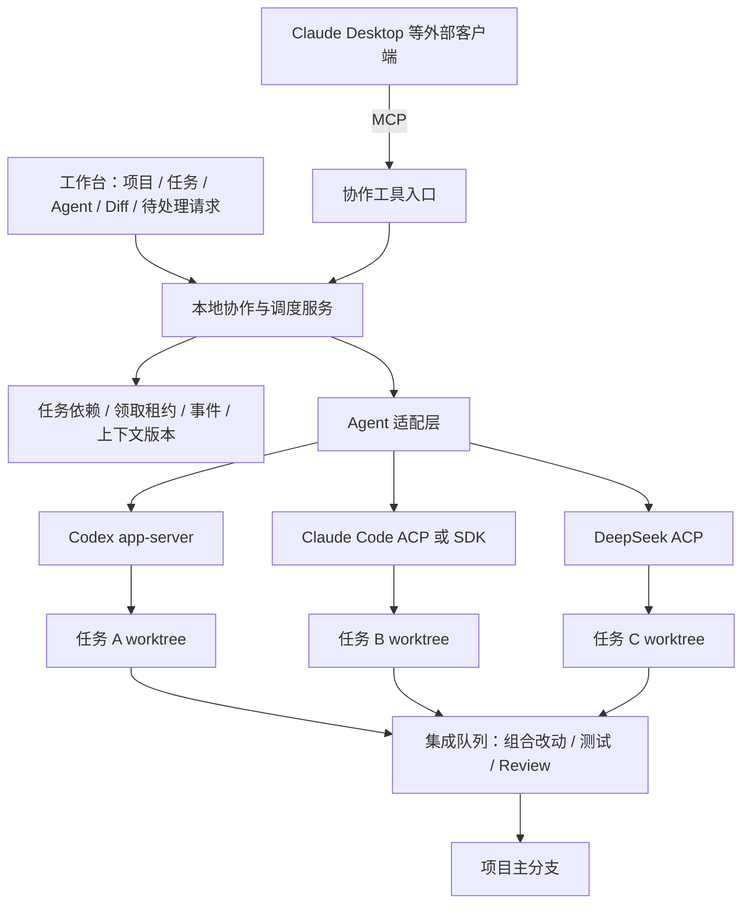

# 多 Agent 协作工作台：GitHub 调研与方案草案

> 历史调研资料：保留 GitHub 候选、来源与早期选型理由。下文架构草案已被 [现行 v1.6 设计包](../README.md) 替代，不作为实施或验收规范。

> 当前完整设计：`../README.md`（2026-11-14 v1.6）。本文保留为前期调研，后续实施以完整设计包为准。

> 需求修订（2026-11-13）：用户明确以“建群、邀请 agent、用户分工、共享上下文”为核心。当前产品方向与选型以同目录的 `2026-11-13-agent-group-chat-platform.md` 为准；本篇保留为执行工作台的初次调研。

调研日期：2026-11-13（Asia/Tokyo）。

这是用于选型与设计讨论的研究草案。已核验项目仓库 README、部分架构文档和厂商接入文档；尚未安装候选软件、运行兼容性测试或审计完整源码。文中的“已提供”指上游文档声明，不能替代本机验证。下文架构、验收标准及阶段安排是针对本需求提出的设计建议。

## 1. 建议与范围

优先评估 Agent Orchestrator，在它通过 Windows 与三个目标 harness 的验证后，基于它扩展项目级协作能力。把 Emdash 作为桌面工作区方案的备选；参考 HarnessDesk 的 Teams、Flows、交接与权限设计；参考 MCP Agent Mail 的任务通信和文件租约思路。

按当前环境，第一版假定：Windows 本地优先、一个使用者、一个 Git 项目、先允许 3 个执行 agent 并发；后续扩展远程机器和多人协作。工作台同时接纳两类参与者：

- 由工作台启动、监控和停止的执行 agent，例如 Codex、Claude Code、DeepSeek Harness。
- 从原客户端主动调用协作工具的外部参与者，例如通过 MCP 接入的 Claude Desktop。

“共同工作区”在产品上表现为同一个项目、任务板、规范和验收结果；代码写入采用每任务独立 worktree。这样可以保留统一体验，又让并发改动具有清晰归属。

## 2. 相近项目与借鉴点

| 项目 / 当前仓库 | 已核验能力 | 对本项目的价值 | 选型边界 |
| --- | --- | --- | --- |
| Agent Orchestrator：OrchestratorInc/agent-orchestrator；原 ComposioHQ 地址会重定向 | Windows/macOS/Linux 客户端；任务独立 branch/worktree；规划与派工；CI、review、merge 反馈；Codex、Claude Code、DeepSeek 等适配 | 优先候选，直接覆盖主要执行链路；可借鉴 adapter、进程宿主、持久化和任务工作区 | Apache-2.0；具体 agent 的 Chat、Terminal、Reviewer 能力不同；需实测 Windows 与版本兼容。[S1][S2][S3] |
| Emdash：generalaction/emdash | 并行 CLI agents、每任务 worktree、diff/PR/CI、SSH 远程项目；有 Windows 安装包 | 桌面项目导航、任务与代码评审体验的主要备选 | Apache-2.0；本次未确认 DeepSeek 的完整专用接入和跨 agent 依赖编排覆盖程度。[S4] |
| HarnessDesk：HarnessDesk/HarnessDesk | Teams、Flows、Run；多厂商 agent 与 ACP；交接包、权限与审计、检查与返工流程 | 与“不同 agent 组成团队”的产品概念高度接近，适合借鉴协作流程与数据模型 | MIT；当前 README 提供 macOS 成品下载，Windows 需另行验证，不能按已有 Windows 产品推荐。[S5] |
| Paradev：ParadevAI/Paradev，原 Superset | 每任务 worktree；并行终端、diff、浏览器预览；CLI、SDK、MCP 接入 | 工作区界面、预览端口管理、终端恢复与 agent 状态 | MIT；当前 Windows 尚不可用，Linux 为实验版。[S6] |
| Vibe Kanban：BloopAI/vibe-kanban | 看板、agent workspace、diff 行内反馈、预览、PR 合并 | 看板和“任务→执行→评审”交互参考 | Apache-2.0；2026-04-10 宣布 bloop 公司关闭，项目继续开源并由社区维护；应评估维护负担。[S7][S8] |
| Claude Squad：smtg-ai/claude-squad | tmux 管理多终端 agent；Git worktree；会话切换和改动预览 | 学习最小运行器与 worktree 生命周期 | AGPL-3.0；依赖 tmux，Windows 本地桌面路线的优先级较低。[S9] |
| MCP Agent Mail：Dicklesworthstone/mcp_agent_mail_rust | MCP 工具、agent 身份、收件箱、线程、建议性文件租约；Git 归档、SQLite 索引 | 外部客户端参与、异步沟通和文件责任边界 | Python 旧版已停止维护；Rust 版许可写有额外 rider，不应当作纯 MIT 直接嵌入；第一版可借鉴机制并自行实现所需的小接口。[S10][S11] |

几个值得纠正的旧信息：Agent Orchestrator 已迁至 OrchestratorInc；Superset 已更名 Paradev；Vibe Kanban 转为社区维护；Agent Mail 应关注 Rust 版。不要依据旧文章的项目名、技术栈或功能矩阵直接决定架构。

## 3. 三条实施路线

| 路线 | 做法 | 收益 | 成本与适用情形 |
| --- | --- | --- | --- |
| A：先采用现成工具 | 安装并配置 Agent Orchestrator，按现有流程使用 | 最快验证真实协作需求 | 若现成功能已足够，可以停止自研；外部 Desktop 参与能力需单独验证 |
| B：在现成工作台上扩展（建议） | 保留 Agent Orchestrator 的 runner、adapter、worktree、评审；补足经验证确实缺少的任务依赖、上下文交接与 MCP 协作接口 | 把开发投入集中到跨 agent 协作 | 需要维护少量上游扩展；是否 fork 取决于源码边界与 PoC 结果 |
| C：独立实现 | 自建桌面壳、后台调度服务和 adapter，再参考上述项目 | 数据模型和交互可完全自定义 | 会重复实现终端、恢复、认证状态、权限回调、Git 和升级兼容；适用于已有明确差异化产品目标 |

当前推荐 B，但先完成 A 的验证。不能在未运行软件之前认定其缺少某功能，也不应在验证前承诺大规模 fork。

## 4. 各 agent 的接入方式

| 对象 | 可用接入依据 | 本方案用法 |
| --- | --- | --- |
| Codex | 官方 app-server 提供双向结构化协议、thread/turn 与权限请求；默认 stdio 传输。[S12] | 托管工作进程优先走 app-server。沿用 Agent Orchestrator 的 native driver。不要把这个能力自动等同于接管任意已打开的 Codex 桌面聊天。 |
| Claude Code | 官方 Agent SDK 可嵌入其 agent loop；CLI 提供非交互输出；Agent Orchestrator 使用 claude-agent-acp 驱动本机 Claude executable。[S2][S13] | 在候选工作台里沿用现有 ACP adapter；只有独立实现时再选择 SDK/CLI，不重复维护两套主路径。 |
| Claude Desktop | 官方支持本地 MCP server 和桌面扩展。[S14] | 安装工作台 MCP 连接，让用户在 Desktop 会话中领取任务、读取上下文和提交结果。默认按“外部参与者”建模。已核验文档不构成后台任意唤醒其 UI 会话的保证。 |
| DeepSeek Harness | 官方仓库包含 @deepseek-ai/dsh-acp，支持自动化会话、恢复、提示和取消；AO 文档以 dsh --profile acp 接入。[S2][S15][S16] | 以原生 ACP 为首选；按运行时 capabilities 展示能力。官方 bridge 明确偏向自动化，不保证完整 UI 轨迹、会话 fork 或 transcript replay。 |
| 其他 agent | ACP 标准化编辑器/客户端与 coding agent 的通信。[S17] | 有 ACP 用 ACP；有官方 SDK 用专用 adapter；仅有 CLI 时以终端接入，并明确标识无法获得的结构化能力。 |

这里应区分两个方向：

- 工作台通过 app-server / ACP / SDK 驱动一个 agent 执行任务。
- agent 通过 MCP 调用工作台提供的任务、上下文、消息和结果工具。

MCP 协作接口不自动赋予工作台启动任意桌面应用会话的能力。也不能把所有 agent 的聊天历史直接拼接成一个可以无损迁移的原生会话。

认证保持 agent 自己的身份和凭证边界。若以后采用 Claude Agent SDK 对外提供产品，应按其官方支持的认证方式设计，不能默认第三方产品可以复用 claude.ai 登录和额度。[S13]

## 5. 建议的整体架构



若选择 Agent Orchestrator，保留它现有的 Go daemon、SQLite、REST/SSE 与 native/ACP drivers。它已经将会话进程宿主与桌面/daemon 生命周期分开，适合借鉴恢复设计。[S3] 不为了统一技术栈先重写运行器。

建议在现有边界上扩展六项职责：

1. **项目规则与契约**：维护项目规范、模块责任、接口 schema、设计决策；为每次任务生成带版本的上下文包。
2. **任务与依赖**：LLM 可以提出拆分，调度服务校验依赖和可执行状态；明确一个 task 可以有多次 run。
3. **运行控制**：启动、取消、等待输入、恢复与能力探测。权限请求由协议回调转成统一 UI 请求。
4. **协作工具**：外部客户端领取任务、收发必要消息、提出接口变更、提交产物。
5. **工作区管理**：每任务分支/worktree、执行目录、端口和构建产物归属；单独管理依赖初始化。
6. **验收与集成**：检查范围、组合分支、运行测试、交叉评审，再进入合并步骤。

数据库保存结构化事实和状态。规范与设计决策保存为可版本控制的文件；消息和运行日志通过服务查询。各 worktree 中的文档快照不自动同步，因此必须记录 spec_version、contract_version、base_commit，并在启动/恢复前检查过期状态。

## 6. 并发协作的规则

### 6.1 每任务一个写入工作区

以一个同时包含前后端的仓库为例：

```text
项目统一视图
├─ T0：接口契约与数据结构 → 先验收并合入基线
├─ T1：后端实现           → worktree/task-T1
├─ T2：前端实现           → worktree/task-T2
├─ T3：接口测试与集成验证 → worktree/task-T3
└─ 集成队列               → worktree/integration
```

T1/T2 可以在 T0 确认后并行。T3 可以先写基于契约的测试，但最终必须在包含 T1/T2 组合结果的候选提交上验收。

建议角色先配置为 Codex 后端、Claude Code 前端、DeepSeek 测试/文档，用户可自由调换；这只是调度示例，不表示已验证这些模型在对应任务上最佳。

共享热点文件（例如依赖清单、lockfile、公共类型、迁移索引）通过明确任务负责，或为变更安排短租约。文件租约只表达占用意图；worktree 也不等同于进程沙箱，不能消除语义冲突。[S6][S10]

### 6.2 共享必要上下文

每个任务发放统一结构的上下文包：目标、验收条件、允许修改范围、依赖任务结果、相关规范版本、接口契约、基准提交和已知限制。

跨 agent 交接交付这些内容：已完成内容、相关提交、测试证据、未解决事项、后续建议。原始对话可以留档，但不默认广播给所有 agent。

接口变更应形成显式的 change request，并标识受影响任务。调度服务决定等待、更新基线或重新执行，避免依赖旧接口的任务被错误标记可合并。

### 6.3 任务状态与执行状态分开

建议 task 状态：待规划、待依赖、可执行、执行中、待验收、待合并、已合并、阻塞、取消。

建议 run 状态：启动中、运行中、等用户输入、已提交结果、失败、已取消。

agent 说“完成”只触发提交结果，不能直接将 task 标记已合并。结果至少关联 head_commit、base_commit、改动清单、测试命令、退出码和日志位置；平台再在集成候选提交上确认检查结果。

### 6.4 合并采用单队列

建议顺序为：收取分支结果 → 校验任务范围 → 更新到当前集成基线 → 构建组合提交 → 针对组合提交测试 → 独立评审 → 合并。

冲突回到具体任务处理，原 worktree 保留。不能仅凭各分支单独通过测试就判断组合结果正确。MVP 不依赖 GitHub PR 才能工作；本地验收可以闭环，PR 作为后续可选出口。

## 7. 最小数据模型和 MCP 接口

这是建议的逻辑模型，不要求替换候选项目已有表结构：

- Project：repo_root、main_branch、spec_version、policy。
- AgentProfile：provider、launch_config、capabilities、权限和预算设置。
- Task：描述、验收条件、依赖、文件范围、owner、version。
- Run：task_id、attempt、native_session_id、worktree、base_commit、运行状态。
- Artifact：提交、diff、文档、测试日志、生成文件及其所属 run。
- Message/Decision：发送方、接收方、task_id、内容、确认状态、上下文版本。
- Approval：请求来源、所需操作、响应结果；与原生 agent 请求 ID 关联。
- Event：单调序号、task/run 归属、类型、载荷、时间。

建议 MCP 的第一批接口保持小而明确：

```text
project_context(project_id, version?)
task_list(project_id, filter)
task_claim(task_id, expected_version)
task_heartbeat(lease_id)
task_report(task_id, run_id, summary, artifacts)
message_send(task_id, recipient, body)
message_poll(agent_id, cursor)
change_request(task_id, affected_contracts, proposal)
```

task_claim 用数据库事务保证原子领取；租约有到期时间与续期。重要变更采用幂等请求 ID。消息默认按任务发送；自动派工、重试和互评设定上限，避免循环触发。

支持能力不能只记录 agent 名称，应包括：结构化输出、恢复、取消、权限回调、工具事件、用量报告、是否可以主动启动。不支持的操作在界面禁用或明确降级；未知用量显示未知，而不是填零。

## 8. 第一版界面

建议采用五个主视图：

1. 项目总览：当前目标、任务依赖、阻塞和最近验收。
2. 任务看板：每张卡显示负责人、分支、依赖、状态与验收证据。
3. Agent 面板：会话、运行输出、能力、等待输入状态和可获取的用量。
4. 改动与验收：diff、测试、评审意见、冲突、合并队列。
5. 协作记录：版本化决策、接口变更、交接包、任务消息和权限请求。

Claude Desktop 在 agent 列表中显示为“外部参与者”，带最近活动和领取任务；不能将连接了 MCP 误显示成“后台可自动唤醒”。

## 9. 分阶段落地与验收

以下为建议的阶段划分，不是工期承诺。先验证底座，再根据真实缺口估算实施量。

| 阶段 | 工作 | 通过条件 |
| --- | --- | --- |
| P0：底座验证 | Windows 上验证 AO 的安装/启动；固定 Codex、Claude Code、DeepSeek 版本；用小仓库各运行一个任务；探测权限、取消、恢复和 worktree 路径 | 形成实测兼容矩阵；三种 harness 至少完成各自任务；不把“已注册 adapter”计为可用 |
| P1：并行执行闭环 | 导入仓库、建任务、指定 agent、创建独立 worktree；集中显示结果和 diff；加入本地验收/合并 | 三个任务并发可追踪；故意制造一次冲突并完成恢复；组合结果通过项目测试 |
| P2：真实分工协作 | 增加必要的任务依赖、上下文版本、接口变更和跨 agent 评审 | 完成“契约→前后端并行→组合测试→合并”的完整功能；依赖过期时正确阻止合并 |
| P3：Desktop 参与与扩展 | MCP 协作入口、Claude Desktop 接入、其他 ACP agent；按需求增加远程执行 | Desktop 能领取任务、读取上下文、提交可验收结果；外部参与能力和自动执行能力区分清楚 |

必须设计并验证的失败场景：

- 两个 agent 同时领取同一任务：只有一个领取成功。
- agent 进程退出：保留 worktree、分支和结果，明确 run 失败或可恢复。
- 桌面/daemon 重启：重建状态，避免重复派工或重复执行具有副作用的操作。
- 用户拒绝权限请求：agent 获得对应拒绝，任务不会永久显示运行中。
- 一个任务改了共享接口：依赖任务得到版本失效提示。
- 各分支测试通过但集成失败：队列停止推进，指定修复任务。
- Windows/WSL 路径差异：先选择一种执行域，跨域须显式做路径与进程映射，不把盘符路径直接传给 Linux 进程。

## 10. 开发前的决策顺序

第一项实证工作应是 AO 的三 agent Windows 兼容验证。通过后，列出它已有能力与本方案的真实差距；优先通过已有 API/扩展点补足，必要时再 fork。

如果 AO 的集成边界不合适，接着验证 Emdash 的运行与界面基础。只有两者都不能满足目标，或已明确需要独立品牌及独特交互时，才启动独立桌面工作台。

第一版的成功标准是：三个不同厂商的 agent 共同交付一个经过组合测试的功能，任何时刻都能知道任务由谁负责、基于哪个版本、正在等什么、产物在哪里、由谁验收。

## 11. 来源索引

以下来源均在 2026-11-13 检索或读取；页面内容可能继续变化。GitHub README 的能力声明和本地实测结果应分别保存。

- [S1] Agent Orchestrator 当前仓库：`https://github.com/OrchestratorInc/agent-orchestrator`
- [S2] Agent Orchestrator adapter 矩阵：`https://docs.orchestrator.inc/plugins/agents/`
- [S3] Agent Orchestrator 架构：`https://github.com/OrchestratorInc/agent-orchestrator/blob/main/docs/architecture.md`
- [S4] Emdash：`https://github.com/generalaction/emdash`
- [S5] HarnessDesk：`https://github.com/HarnessDesk/HarnessDesk`
- [S6] Paradev（原 Superset）：`https://github.com/ParadevAI/Paradev`
- [S7] Vibe Kanban：`https://github.com/BloopAI/vibe-kanban`
- [S8] 2026-04-10 Goodbye bloop：`https://www.vibekanban.com/blog/shutdown`
- [S9] Claude Squad：`https://github.com/smtg-ai/claude-squad`
- [S10] MCP Agent Mail Rust：`https://github.com/Dicklesworthstone/mcp_agent_mail_rust`
- [S11] MCP Agent Mail Python 的弃用说明：`https://github.com/Dicklesworthstone/mcp_agent_mail`
- [S12] Codex app-server 官方文档：`https://developers.openai.com/codex/app-server/`（本次跳转至 `https://learn.chatgpt.com/docs/app-server`）
- [S13] Claude Agent SDK：`https://code.claude.com/docs/en/agent-sdk/overview`
- [S14] Claude Desktop 本地 MCP：`https://support.claude.com/en/articles/10949351-getting-started-with-local-mcp-servers-on-claude-desktop`
- [S15] DeepSeek Harness：`https://github.com/deepseek-ai/deepseek-harness`
- [S16] 官方 ACP package：`https://github.com/deepseek-ai/deepseek-harness/blob/master/packages/acp/acp/README.md`
- [S17] ACP 协议仓库：`https://github.com/agentclientprotocol/agent-client-protocol`


